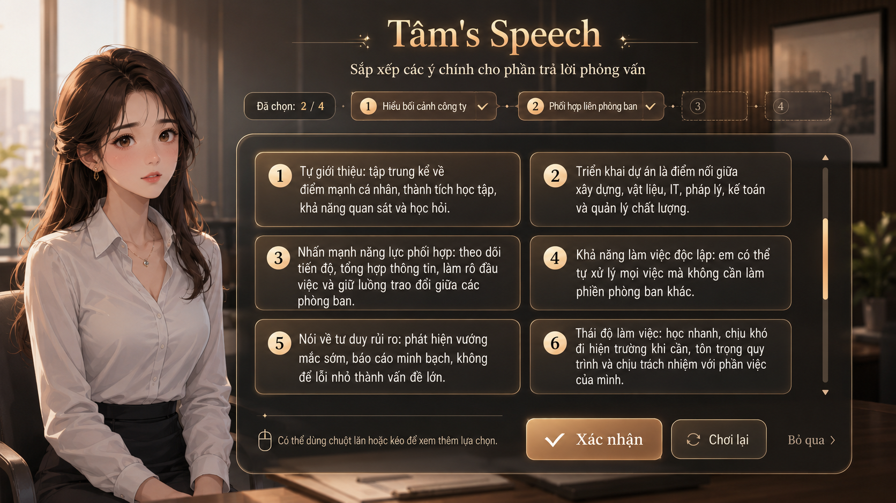

# Technical Guide — Implementing “Tâm’s Speech” Mini-game UI in Ren’Py
## Suggested UI Design: 
## 1. Target

Implement a polished full-screen interview mini-game UI for Chapter 01 — Tâm Route.

The mini-game allows the player to select **4 speech ideas** from a shuffled list. The game then evaluates:

```text
Required ideas:
1. context
2. coordination
3. risk
4. commitment
```

Outcomes:

```text
Perfect:
- Contains all required ideas
- Correct order
- Bonus salary / confidence / work skill

Pass:
- Contains all required ideas
- Wrong order
- Standard salary / smaller bonus

Fail:
- Missing required ideas
- Retry until 3 failures
- After 3 failures, allow Skip
```

---

# 2. Recommended Implementation Strategy

## Do not implement the UI as a flat screenshot

The mockup looks good, but using it directly as a single image would cause problems:

```text
Bad approach:
- Text becomes baked into the image
- Cannot localize easily
- Cannot shuffle choices dynamically
- Cannot show selected choices dynamically
- Cannot resize or theme cleanly
- Hard to support hover/selected states
```

## Correct approach

Build it as layered Ren’Py UI:

```text
Layer 1: blurred interview room background
Layer 2: dark overlay
Layer 3: Tâm portrait sprite
Layer 4: main translucent panel
Layer 5: title, subtitle, selected chips
Layer 6: two-column scrollable choice cards
Layer 7: confirm / retry / skip buttons
```

Ren’Py styles can customize displayables such as windows, buttons, and text; hover/idle states should be handled through style properties rather than baked into images. ([Ren'Py][2])

---

# 3. File Structure

Recommended structure:

```text
game/
  images/
    assets/
      bg/
        tam_c01/
          bg_interview_room.webp
          bg_interview_room_blur.webp

      characters/
        tam/
          tam_interview_neutral.png
          tam_interview_worried.png
          tam_interview_serious.png
          tam_interview_smile.png

      ui/
        speech/
          # Optional polish assets later:
          panel_bg.png
          card_idle.png
          card_hover.png
          card_selected.png
          button_primary_idle.png
          button_primary_hover.png
          button_secondary_idle.png
          button_secondary_hover.png

  tam_c01_speech_data.rpy
  tam_c01_speech_screen.rpy
  route_tam_c01.rpy
```

For the first implementation, you can skip custom UI image assets and use pure Ren’Py `Solid`, `Frame`, `button`, `text`, and `vpgrid`.

---

# 4. Required Assets

## Minimum assets

```text
images/assets/bg/tam_c01/bg_interview_room_blur.webp
images/assets/characters/tam/tam_interview_worried.png
```

## Recommended assets

```text
bg_interview_room.webp
bg_interview_room_blur.webp

tam_interview_neutral.png
tam_interview_worried.png
tam_interview_serious.png
tam_interview_smile.png
```

The blurred background can be pre-rendered from the interview room background. Do not rely on runtime blur unless you are prepared to write custom displayable code. Pre-rendering is simpler and safer.

---

# 5. Image Declarations

Create or update:

```text
game/tam_c01_images.rpy
```

```renpy
# ============================================================
# Tâm Route - Chapter 01 Images
# ============================================================

image bg_interview_room = "images/assets/bg/tam_c01/bg_interview_room.webp"
image bg_interview_room_blur = "images/assets/bg/tam_c01/bg_interview_room_blur.webp"

image tam interview neutral = "images/assets/characters/tam/tam_interview_neutral.png"
image tam interview worried = "images/assets/characters/tam/tam_interview_worried.png"
image tam interview serious = "images/assets/characters/tam/tam_interview_serious.png"
image tam interview smile = "images/assets/characters/tam/tam_interview_smile.png"
```

---

# 6. Mini-game Data

Create:

```text
game/tam_c01_speech_data.rpy
```

```renpy
# ============================================================
# Tâm Route - Chapter 01 Speech Mini-game Data
# ============================================================

default tam_speech_attempts = 0
default tam_speech_order = []

init python:

    tam_speech_required_order = [
        "context",
        "coordination",
        "risk",
        "commitment",
    ]

    tam_speech_short_labels = {
        "self_only": "Tự giới thiệu",
        "context": "Hiểu bối cảnh công ty",
        "coordination": "Phối hợp liên phòng ban",
        "solo": "Làm việc độc lập",
        "risk": "Tư duy rủi ro",
        "commitment": "Thái độ làm việc",
        "salary_first": "Quan tâm mức lương",
    }

    tam_speech_items = [
        {
            "id": "self_only",
            "label": "Tự giới thiệu: tập trung kể về điểm mạnh cá nhân, thành tích học tập, khả năng quan sát và học hỏi.",
        },
        {
            "id": "context",
            "label": "Triển khai dự án là điểm nối giữa xây dựng, vật liệu, IT, pháp lý, kế toán và quản lý chất lượng.",
        },
        {
            "id": "coordination",
            "label": "Nhấn mạnh năng lực phối hợp: theo dõi tiến độ, tổng hợp thông tin, làm rõ đầu việc và giữ luồng trao đổi giữa các phòng ban.",
        },
        {
            "id": "solo",
            "label": "Khả năng làm việc độc lập: em có thể tự xử lý mọi việc mà không cần làm phiền phòng ban khác.",
        },
        {
            "id": "risk",
            "label": "Nói về tư duy rủi ro: phát hiện vướng mắc sớm, báo cáo minh bạch, không để lỗi nhỏ thành vấn đề lớn.",
        },
        {
            "id": "commitment",
            "label": "Thái độ làm việc: học nhanh, chịu khó đi hiện trường khi cần, tôn trọng quy trình và chịu trách nhiệm với phần việc của mình.",
        },
        {
            "id": "salary_first",
            "label": "Nói rằng mức lương là điều em quan tâm nhất vì em muốn được đánh giá đúng giá trị.",
        },
    ]


    def tam_speech_toggle_choice(picked, item_id):
        """
        Mutates the local picked list used by the screen.

        Rules:
        - If the item is already selected, remove it.
        - If it is not selected and fewer than 4 items are selected, add it.
        """

        if item_id in picked:
            picked.remove(item_id)

        elif len(picked) < 4:
            picked.append(item_id)

        renpy.restart_interaction()


    def tam_speech_is_perfect(order):
        return order == tam_speech_required_order


    def tam_speech_has_required(order):
        return all(x in order for x in tam_speech_required_order)
```

---

# 7. Screen Implementation

Create:

```text
game/tam_c01_speech_screen.rpy
```

This version implements:

```text
- Full-screen UI
- Blurred interview room background
- Tâm portrait on the left
- Header title
- Selected-order chips
- Two-column scrollable choice grid
- Confirm / Retry / Skip buttons
- Dynamic selected card state
```

Ren’Py’s `Return(value)` action is suitable here because it returns a value from the interaction/screen back to script control. ([Ren'Py][3])

```renpy
# ============================================================
# Tâm Route - Chapter 01 Speech Mini-game Screen
# ============================================================

transform tam_speech_portrait_pos:
    xpos 45
    ypos 132
    zoom 0.92


screen tam_speech_minigame(items, attempt=1, can_skip=False):

    modal True
    zorder 100

    default picked = []

    fixed:
        xysize (1920, 1080)

        add "bg_interview_room_blur"

        add Solid("#00000088")

        add "tam interview worried" at tam_speech_portrait_pos

        # ----------------------------------------------------
        # Header
        # ----------------------------------------------------

        vbox:
            xpos 560
            ypos 34
            xsize 1200
            spacing 8

            text "Tâm's Speech" style "tam_speech_title" xalign 0.5

            text "Sắp xếp các ý chính cho phần trả lời phỏng vấn" style "tam_speech_subtitle" xalign 0.5

        # ----------------------------------------------------
        # Selected progress strip
        # ----------------------------------------------------

        hbox:
            xpos 520
            ypos 154
            spacing 16

            frame:
                style "tam_speech_progress_badge"
                xysize (190, 62)

                text "Đã chọn: [len(picked)] / 4" style "tam_speech_progress_text" xalign 0.5 yalign 0.5

            for i in range(4):

                if i < len(picked):

                    frame:
                        style "tam_speech_selected_chip"
                        xysize (255, 62)

                        hbox:
                            spacing 8
                            xalign 0.5
                            yalign 0.5

                            text "[i + 1]" style "tam_speech_chip_number"
                            text "[tam_speech_short_labels[picked[i]]]" style "tam_speech_chip_text"
                            text "✓" style "tam_speech_chip_check"

                else:

                    frame:
                        style "tam_speech_empty_chip"
                        xysize (145, 62)

                        text "[i + 1]" style "tam_speech_empty_chip_text" xalign 0.5 yalign 0.5

        # ----------------------------------------------------
        # Main panel
        # ----------------------------------------------------

        frame:
            style "tam_speech_main_panel"
            xpos 500
            ypos 244
            xysize (1360, 690)

            fixed:

                # Choice grid.
                #
                # vpgrid is used because it combines grid layout and viewport
                # scrolling. Children must keep the same size for reliable
                # rendering.
                vpgrid:
                    cols 2
                    spacing 16
                    xpos 36
                    ypos 36
                    xsize 1210
                    ysize 460
                    draggable True
                    mousewheel True
                    scrollbars "vertical"

                    for index, item in enumerate(items):

                        $ item_id = item["id"]
                        $ selected = item_id in picked

                        button:
                            style "tam_speech_card_button"
                            xysize (580, 136)

                            background Solid("#3A3025E8") if selected else Solid("#171717DD")
                            hover_background Solid("#3A3328F2")

                            action Function(tam_speech_toggle_choice, picked, item_id)

                            hbox:
                                spacing 18
                                xfill True
                                yfill True

                                frame:
                                    style "tam_speech_card_number_badge"
                                    xysize (54, 54)
                                    yalign 0.08

                                    text "[index + 1]" style "tam_speech_card_number_text" xalign 0.5 yalign 0.5

                                vbox:
                                    spacing 4
                                    yalign 0.5
                                    xmaximum 465

                                    text item["label"] style "tam_speech_card_text"

                                if selected:
                                    text "✓" style "tam_speech_card_check" yalign 0.12

                # Hint line.
                hbox:
                    xpos 42
                    ypos 535
                    spacing 12

                    text "⌁" style "tam_speech_hint_icon"
                    text "Có thể dùng chuột lăn hoặc kéo để xem thêm lựa chọn." style "tam_speech_hint"

                # Action buttons.
                hbox:
                    xpos 650
                    ypos 575
                    spacing 22

                    textbutton "✓  Xác nhận":
                        style "tam_speech_confirm_button"
                        text_style "tam_speech_confirm_button_text"
                        sensitive len(picked) == 4
                        action Return(("confirm", list(picked)))

                    textbutton "↻  Chơi lại":
                        style "tam_speech_secondary_button"
                        text_style "tam_speech_secondary_button_text"
                        action Return(("retry", []))

                    if can_skip:
                        textbutton "Bỏ qua ›":
                            style "tam_speech_skip_button"
                            text_style "tam_speech_skip_button_text"
                            action Return(("skip", []))


# ============================================================
# Styles
# ============================================================

style tam_speech_title is default:
    size 58
    bold True
    color "#F5D7A6"
    outlines [(2, "#2A1608", 0, 0)]


style tam_speech_subtitle is default:
    size 28
    color "#F7E8D0"
    outlines [(1, "#000000", 0, 0)]


style tam_speech_progress_badge is frame:
    background Solid("#1B1713DD")
    padding (16, 8)


style tam_speech_progress_text is default:
    size 22
    color "#F7E8D0"


style tam_speech_selected_chip is frame:
    background Solid("#4A3420DD")
    padding (14, 8)


style tam_speech_empty_chip is frame:
    background Solid("#16120F99")
    padding (12, 8)


style tam_speech_chip_number is default:
    size 20
    bold True
    color "#3A2412"


style tam_speech_chip_text is default:
    size 18
    color "#FFF2DC"
    xmaximum 160


style tam_speech_chip_check is default:
    size 24
    color "#FFDDAA"


style tam_speech_empty_chip_text is default:
    size 22
    color "#A88F70"


style tam_speech_main_panel is frame:
    background Solid("#111111DD")
    padding (0, 0)


style tam_speech_card_button is button:
    padding (20, 18)


style tam_speech_card_number_badge is frame:
    background Solid("#F6D8A5")
    padding (0, 0)


style tam_speech_card_number_text is default:
    size 24
    bold True
    color "#3A2412"


style tam_speech_card_text is default:
    size 23
    color "#FFFFFF"
    line_spacing 2
    layout "subtitle"
    outlines [(1, "#000000", 0, 0)]


style tam_speech_card_check is default:
    size 30
    color "#FFDDAA"


style tam_speech_hint_icon is default:
    size 24
    color "#D7B77D"


style tam_speech_hint is default:
    size 21
    color "#D7C7B2"


style tam_speech_confirm_button is button:
    background Solid("#C98A48")
    hover_background Solid("#E2A85F")
    insensitive_background Solid("#6B5B4A")
    xysize (270, 72)
    padding (20, 12)


style tam_speech_confirm_button_text is button_text:
    size 30
    bold True
    color "#FFFFFF"
    insensitive_color "#B8B8B8"


style tam_speech_secondary_button is button:
    background Solid("#211A15DD")
    hover_background Solid("#33271DDD")
    xysize (210, 72)
    padding (20, 12)


style tam_speech_secondary_button_text is button_text:
    size 25
    color "#F7E8D0"
    hover_color "#FFDDAA"


style tam_speech_skip_button is button:
    background Solid("#00000000")
    hover_background Solid("#2A2118AA")
    xysize (160, 72)
    padding (16, 12)


style tam_speech_skip_button_text is button_text:
    size 24
    color "#C9AD86"
    hover_color "#FFDDAA"
```

---

# 8. Script Integration

Replace the previous mini-game `menu:` logic with this screen-driven logic.

In:

```text
game/route_tam_c01.rpy
```

use:

```renpy
# ============================================================
# Chapter 01 interview minigame and outcomes
# ============================================================

label tam_c01_speech_game:

    $ tam_speech_attempts = 0

label tam_c01_speech_retry:

    $ tam_speech_order = []
    $ tam_speech_required = list(tam_speech_required_order)

    # Shuffle once per attempt.
    $ tam_speech_pool = list(tam_speech_items)
    $ renpy.random.shuffle(tam_speech_pool)

    narrator "Mini-game: Sắp xếp các ý chính cho phần trả lời phỏng vấn."
    narrator "Chọn 4 ý cần trình bày. Nếu chọn đủ ý đúng thì pass. Nếu đúng cả ý lẫn thứ tự sẽ nhận bonus."

    $ tam_speech_result = renpy.call_screen(
        "tam_speech_minigame",
        items=tam_speech_pool,
        attempt=tam_speech_attempts + 1,
        can_skip=(tam_speech_attempts >= 3)
    )

    $ tam_speech_action = tam_speech_result[0]
    $ tam_speech_order = tam_speech_result[1]

    if tam_speech_action == "retry":
        jump tam_c01_speech_retry

    if tam_speech_action == "skip":
        jump tam_c01_interview_skip_from_minigame

    $ tam_speech_has_required = tam_speech_has_required(tam_speech_order)
    $ tam_speech_perfect_order = tam_speech_is_perfect(tam_speech_order)

    if tam_speech_has_required:

        if tam_speech_perfect_order:
            $ tam_salary_tier = "high"
            $ tam_work_skill += 2
            $ tam_confidence += 2
            $ add_unique(progress["player_flags"], "tam_interview_passed")
            $ add_unique(progress["player_flags"], "tam_interview_bonus_order")
            $ add_unique(progress["player_flags"], "tam_salary_high_start")
            $ add_unique(progress["player_flags"], "tam_work_skill_strong_c01")

            narrator "Các ý được đặt đúng thứ tự."
            narrator "Tâm mở đầu bằng việc hiểu bức tranh lớn, sau đó đi vào năng lực phối hợp, tư duy rủi ro, rồi mới kết lại bằng thái độ làm việc."
            narrator "Một câu trả lời không quá hoa mỹ. Nhưng gọn, có trục, và không bị rơi vào kiểu tự quảng cáo non tay."

            jump tam_c01_interview_perfect

        else:
            $ tam_salary_tier = "standard"
            $ tam_work_skill += 1
            $ tam_confidence += 1
            $ add_unique(progress["player_flags"], "tam_interview_passed")
            $ add_unique(progress["player_flags"], "tam_salary_standard_start")

            narrator "Các ý quan trọng đều có mặt, nhưng thứ tự trình bày chưa thật sự sắc."
            narrator "Dù vậy, Tâm vẫn cho thấy cô hiểu công việc và có thái độ nghiêm túc."

            jump tam_c01_interview_pass

    else:

        $ tam_speech_attempts += 1

        if tam_speech_attempts < 3:
            narrator "Câu trả lời bị lệch trọng tâm."
            narrator "Hội đồng không khó chịu, nhưng ánh mắt họ đủ khiến Tâm hiểu mình vừa đi sai hướng."
            narrator "Thử lại."

            jump tam_c01_speech_retry

        else:
            narrator "Tâm đã thất bại 3 lần trong phần sắp xếp ý."
            narrator "Có thể chơi lại để lấy bonus, hoặc bỏ qua để pass nhưng không nhận điểm thưởng."

            # Now call the same screen again, but with Skip enabled.
            $ tam_speech_pool = list(tam_speech_items)
            $ renpy.random.shuffle(tam_speech_pool)

            $ tam_speech_result = renpy.call_screen(
                "tam_speech_minigame",
                items=tam_speech_pool,
                attempt=tam_speech_attempts + 1,
                can_skip=True
            )

            $ tam_speech_action = tam_speech_result[0]
            $ tam_speech_order = tam_speech_result[1]

            if tam_speech_action == "retry":
                jump tam_c01_speech_retry

            if tam_speech_action == "skip":
                jump tam_c01_interview_skip_from_minigame

            jump tam_c01_speech_retry


label tam_c01_interview_skip_from_minigame:

    $ tam_salary_tier = "standard"
    $ add_unique(progress["player_flags"], "tam_interview_pass_skip_no_bonus")
    $ add_unique(progress["player_flags"], "tam_salary_standard_start")

    narrator "Tâm hít sâu, bỏ qua sự hoàn hảo mà mình vẫn luôn muốn giữ."
    narrator "Cô trả lời theo cách an toàn hơn, vừa đủ để không bị loại, nhưng cũng không tạo được điểm sáng đặc biệt."

    jump tam_c01_interview_skip
```

---

# 9. Existing Outcome Labels

Keep these labels from your current script.

```renpy
label tam_c01_interview_perfect:

    tam serious "Em nghĩ vị trí triển khai dự án không chỉ là truyền đạt thông tin từ bên này sang bên kia."

    tam serious "Với một công ty có nhiều mảng như xây dựng, vật liệu, IT, pháp lý, kế toán và quản lý chất lượng, người ở phòng triển khai cần hiểu được việc của mình nằm ở đâu trong toàn bộ dòng chảy dự án."

    tam serious "Nếu em không hiểu bối cảnh, em sẽ chỉ chuyển tiếp thông tin. Nhưng nếu hiểu bối cảnh, em có thể biết thông tin nào cần làm rõ, phòng ban nào cần được cập nhật, và rủi ro nào nên được báo sớm."

    tam neutral "Em chưa có nhiều kinh nghiệm thực tế, nhưng em có khả năng tổng hợp, theo dõi chi tiết, và em không ngại học quy trình từ đầu."

    tam smile "Em muốn làm tốt phần việc của mình theo cách đáng tin cậy. Không ồn ào, nhưng rõ ràng và có trách nhiệm."

    manager "Cách em trả lời khá có cấu trúc."

    interviewer "Và thực tế hơn anh chị nghĩ."

    narrator "Tâm thấy vai mình nhẹ đi một chút."

    narrator "Không phải vì cô chắc chắn mình đã thắng."

    narrator "Chỉ là lần đầu tiên trong buổi sáng hôm ấy, cô thấy mình đang đứng đúng chỗ."

    jump tam_c01_after_interview


label tam_c01_interview_pass:

    tam serious "Em nghĩ công việc triển khai dự án cần khả năng phối hợp và theo dõi chi tiết."

    tam serious "Công ty mình có nhiều phòng ban liên quan đến từng dự án, nên nếu thông tin không rõ ràng hoặc cập nhật chậm, tiến độ chung có thể bị ảnh hưởng."

    tam neutral "Em muốn học cách nắm quy trình, hỗ trợ các bên làm việc với nhau tốt hơn và báo cáo kịp thời khi có vướng mắc."

    manager "Tốt. Câu trả lời hơi vòng một chút, nhưng ý chính ổn."

    interviewer "Chị đánh giá cao việc em có nhắc đến phối hợp liên phòng ban."

    narrator "Tâm gật đầu."

    narrator "Cô biết mình chưa thật xuất sắc, nhưng ít nhất không bị trôi."

    jump tam_c01_after_interview


label tam_c01_interview_skip:

    tam serious "Em nghĩ vị trí này cần sự cẩn thận, khả năng phối hợp và tinh thần học hỏi."

    tam sad "Em chưa có nhiều kinh nghiệm, nhưng em sẵn sàng học quy trình, hỗ trợ công việc và làm theo hướng dẫn của cấp trên."

    manager "Được."

    narrator "Một câu trả lời an toàn."

    narrator "Không sai. Nhưng cũng không để lại nhiều dư âm."

    jump tam_c01_after_interview
```

---

# 10. Design Notes

## 10.1 Two-column layout

Use `vpgrid cols 2`. Ren’Py’s `vpgrid` combines grid layout with viewport scrolling, and is optimized so only currently displayed children are rendered. It expects children to have consistent size, so every card should use the same `xysize`. ([Ren'Py][1])

```renpy
vpgrid:
    cols 2
    spacing 16
    draggable True
    mousewheel True
    scrollbars "vertical"
```

## 10.2 Scroll support

Enable:

```renpy
draggable True
mousewheel True
scrollbars "vertical"
```

Ren’Py viewports support scrolling by dragging, mouse wheel, and scrollbars. ([Ren'Py][1])

## 10.3 Text handling

Use smaller text sizes and `layout "subtitle"` for long Vietnamese strings:

```renpy
style tam_speech_card_text is default:
    size 23
    layout "subtitle"
    line_spacing 2
```

Ren’Py UI text can be displayed through screen language statements like `text`, `textbutton`, and `label`, and text is styled before layout and drawing. ([Ren'Py][4])

---

# 11. Polish Pass — Optional Image Assets

The pure-code version above will work, but it will not exactly match the generated mockup’s glow, gradients, and decorative gold borders.

For a more premium look, create these assets:

```text
images/assets/ui/speech/panel_bg.png
images/assets/ui/speech/card_idle.png
images/assets/ui/speech/card_hover.png
images/assets/ui/speech/card_selected.png
images/assets/ui/speech/chip_selected.png
images/assets/ui/speech/chip_empty.png
images/assets/ui/speech/button_primary_idle.png
images/assets/ui/speech/button_primary_hover.png
images/assets/ui/speech/button_secondary_idle.png
images/assets/ui/speech/button_secondary_hover.png
```

Then replace `Solid(...)` backgrounds with `Frame(...)`.

Example:

```renpy
style tam_speech_main_panel is frame:
    background Frame("images/assets/ui/speech/panel_bg.png", 32, 32)
```

```renpy
style tam_speech_confirm_button is button:
    background Frame("images/assets/ui/speech/button_primary_idle.png", 24, 24)
    hover_background Frame("images/assets/ui/speech/button_primary_hover.png", 24, 24)
```

This is the best long-term route if you want the UI to look close to the mockup.

---

# 12. Known Limitations

## 12.1 Exact mockup fidelity

Ren’Py can absolutely implement this UI, but matching the mockup **pixel-perfectly** requires custom UI image assets. Pure screen language will get the structure and usability right, but gradients/glow/borders may look simpler.

## 12.2 Runtime blur

Use a pre-blurred background image:

```text
bg_interview_room_blur.webp
```

Do not depend on runtime blur for the first build.

## 12.3 Fonts

Use a font you are licensed to distribute. Do not rely on local system fonts unless you are only testing. Keep Vietnamese diacritics support in mind.

Recommended font roles:

```text
Title:
- Elegant serif or display font with Vietnamese support

Body/UI:
- Clean sans-serif with Vietnamese support
```

---

# 13. QA Checklist

```text
[ ] Screen opens from interview scene.
[ ] Choices are shuffled each attempt.
[ ] Player can select and unselect choices.
[ ] Confirm is disabled until 4 choices are selected.
[ ] Selected chips show the chosen order.
[ ] Choice cards visually indicate selected state.
[ ] Choice grid scrolls with mouse wheel.
[ ] Choice grid scrolls by dragging.
[ ] Retry clears picked choices and reshuffles.
[ ] After 3 failed attempts, Skip appears.
[ ] Perfect order grants high salary.
[ ] Correct ideas in wrong order grants standard pass.
[ ] Missing required ideas causes fail/retry.
[ ] Text does not overflow at 1920x1080.
[ ] Ren’Py lint passes.
```

---

# 14. Recommended Implementation Plan

## Phase 1 — Functional MVP

Use the code above with:

```text
Solid color panels
Plain rectangular buttons
Default scrollbar
Pre-blurred background
Tâm portrait sprite
```

Goal: make the mini-game work.

## Phase 2 — Visual Polish

Replace solids with image-based `Frame(...)` assets:

```text
panel_bg
choice_card_idle
choice_card_hover
choice_card_selected
primary_button_idle
primary_button_hover
```

Goal: match the generated UI mockup more closely.

## Phase 3 — UX Polish

Add:

```text
hover sound
confirm sound
wrong-answer feedback sound
soft screen transition
small highlight animation for selected chips
```

---

# 15. Final Verdict

This UI is feasible in Ren’Py.

The practical build should be:

```text
Ren’Py Screen Language for structure
vpgrid for two-column scrolling choice cards
Return actions for mini-game result
Styles for typography and button states
Optional Frame image assets for premium polish
```

The mockup is a good **visual target**, but the actual in-game UI should be rebuilt as interactive Ren’Py components. Otherwise it will look pretty, then immediately betray us the moment a line of text changes. Very beautiful sabotage.

[1]: https://www.renpy.org/doc/html/screens.html "Screens and Screen Language — Ren'Py Documentation"
[2]: https://www.renpy.org/doc/html/style.html "Styles — Ren'Py Documentation"
[3]: https://www.renpy.org/doc/html/screen_actions.html "Screen Actions, Values, and Functions — Ren'Py Documentation"
[4]: https://www.renpy.org/doc/html/text.html "Text — Ren'Py Documentation"
