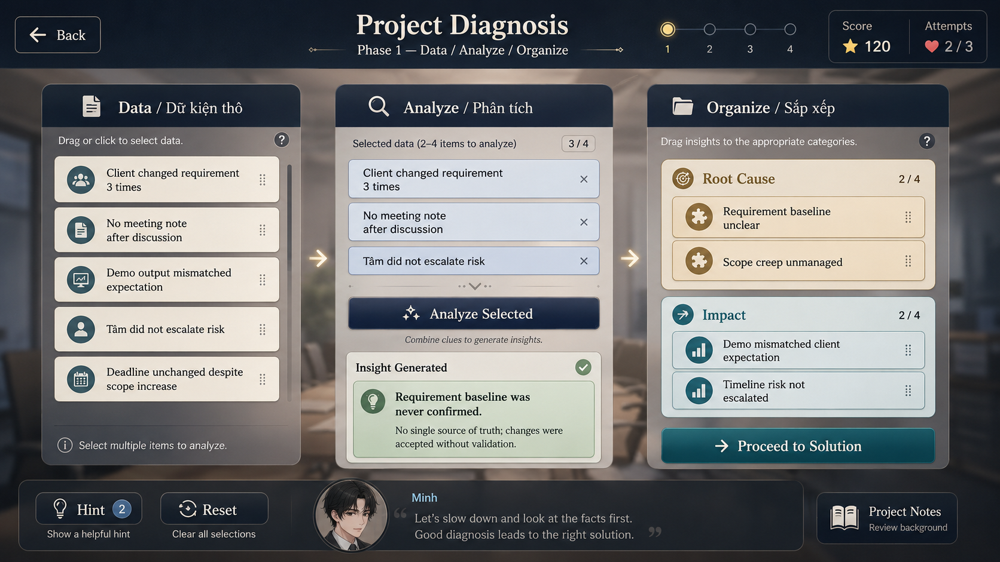
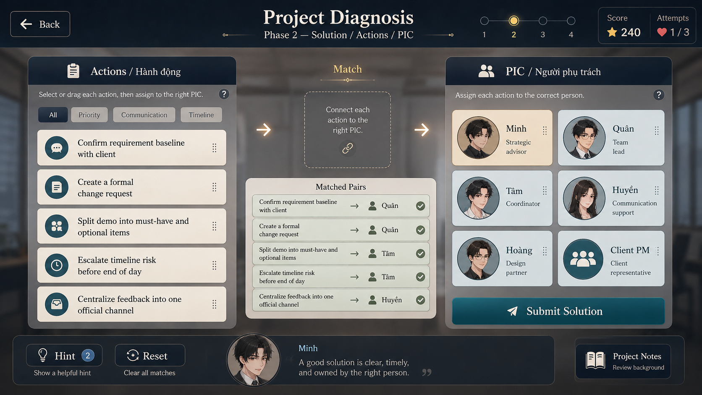

# Technical Implementation Guide

## Problem Diagnosis Minigame — Ren’Py Implementation Spec

This document describes how to implement the **Problem Diagnosis / Project Diagnosis** minigame in Ren’Py.

The minigame has two major phases:

```text
Phase 1: Data → Analyze → Organize
Phase 2: Solution → Action / PIC Matching
```

The design should be implemented as a **screen-based puzzle**, not as a real-time arcade minigame. Ren’Py is suitable for this because its screen language supports custom UI screens, buttons, text, images, bars, and interactive screen actions. Ren’Py also supports drag-and-drop through `Drag` and `DragGroup`, but the recommended MVP should use click-based interaction first, then add drag-and-drop later as polish. ([Ren'Py][1])



---

# 1. Gameplay Overview

## Core Loop

```text
1. Player reads raw project data.
2. Player selects 2–4 related data cards.
3. Player analyzes the selected cards.
4. If the selected combination is valid, an Insight Card is generated.
5. Player organizes raw data and generated insights into:
   - Root Cause
   - Impact
6. If Phase 1 score is high enough, player proceeds to Phase 2.
7. Player matches each Solution Action to the correct PIC / owner.
8. Game evaluates the result.
9. Result affects route variables, relationship scores, project risk, and unlocks.
```

## Recommended Result Tiers

The minigame should not hard-fail the player. Use a **fail-forward** model.

```text
Excellent:
- Strong diagnosis.
- Correct root causes.
- Correct impacts.
- Correct action ownership.
- Unlocks best narrative outcome.

Good:
- Mostly correct.
- Project continues with positive result.

Mixed:
- Partially correct.
- Some tension, rework, or mentor correction.

Poor:
- Wrong diagnosis or poor solution.
- Project risk increases.
- Unlocks repair scene instead of blocking the route.
```

---

# 2. Recommended File Structure

Use a separated minigame folder.

```text
game/
  minigames/
    problem_diagnosis/
      problem_diagnosis_data.rpy
      problem_diagnosis_logic.rpy
      problem_diagnosis_screens.rpy
      problem_diagnosis_styles.rpy
```

## File Responsibilities

```text
problem_diagnosis_data.rpy
- Case definitions.
- Data cards.
- Insight recipes.
- Organize scoring rules.
- Action/PIC matching rules.

problem_diagnosis_logic.rpy
- Runtime state.
- Select/unselect logic.
- Analyze logic.
- Organize logic.
- Phase transition logic.
- Scoring.
- Result generation.

problem_diagnosis_screens.rpy
- Phase 1 screen.
- Phase 2 screen.
- Card components.
- Header/footer components.
- Result popup.

problem_diagnosis_styles.rpy
- UI styles.
- Fonts, colors, frame backgrounds, button styles.
```

---

# 3. Narrative Integration

Call the minigame from a story label.

Example:

```renpy
label c16_project_crisis:

    scene bg office_meeting_room_blur

    minh "Let's slow down and look at the facts first."

    call problem_diagnosis_start("case_scope_creep_01")

    if pd_last_result["tier"] == "excellent":
        $ career_tam += 2
        $ minh_respect_tam += 2
        $ quan_respect_tam += 1
        $ project_risk -= 2
        jump c16_project_crisis_success

    elif pd_last_result["tier"] == "good":
        $ career_tam += 1
        $ project_risk -= 1
        jump c16_project_crisis_good

    elif pd_last_result["tier"] == "mixed":
        $ tam_learning += 1
        $ project_risk += 1
        jump c16_project_crisis_repair

    else:
        $ project_risk += 2
        $ doom_score += 1
        jump c16_project_crisis_failure
```

The minigame should return one result object into:

```renpy
$ pd_last_result = { ... }
```

---

# 4. State Machine

Use a simple state machine.

```text
INIT
→ PHASE_1_ANALYZE
→ PHASE_1_ORGANIZE
→ PHASE_1_EVALUATION
→ PHASE_2_MATCH
→ PHASE_2_EVALUATION
→ RESULT
→ RETURN_TO_STORY
```

Recommended runtime state:

```python
pd_state = {
    "case_id": None,

    "phase": 1,

    "selected_data_ids": [],
    "generated_insight_ids": [],

    "selected_card_id": None,

    "root_cause_slots": [],
    "impact_slots": [],

    "selected_action_id": None,
    "action_pic_pairs": {},

    "phase_1_score": 0,
    "phase_2_score": 0,
    "total_score": 0,

    "attempts_left": 3,
    "hints_left": 2,

    "feedback_message": "",
    "created_insight_id": None,
}
```

Use normal Ren’Py store variables for runtime state. Screen variables can be used for local UI state, but global gameplay results should be stored in normal store variables so they can be accessed after the screen returns. Ren’Py’s screen actions include variable-setting actions such as `SetVariable` and `SetScreenVariable`; use screen-local state only for UI-specific data, and store-level state for gameplay results. ([Ren'Py][2])

---

# 5. Data Model

## 5.1 Case Definition

Each minigame case should be data-driven.

```python
PD_CASES = {
    "case_scope_creep_01": {
        "title": "Demo Mismatch",
        "description": "The project demo does not match the client's expectation.",
        "phase_1_required_score": 60,

        "data_cards": [...],
        "insight_cards": {...},
        "analysis_recipes": [...],
        "organize_rules": {...},

        "actions": [...],
        "pics": [...],
        "pic_rules": {...},

        "result_effects": {...}
    }
}
```

---

## 5.2 Raw Data Card

```python
{
    "id": "D01",
    "type": "raw",
    "title": "Client changed requirement 3 times",
    "description": "The client changed the expected output three times within two weeks.",
    "tags": ["requirement", "client", "scope"],
    "icon": "people"
}
```

---

## 5.3 Insight Card

Insight cards are generated from valid combinations of raw data.

```python
{
    "id": "I01",
    "type": "insight",
    "title": "Requirement baseline was never confirmed",
    "description": "There is no single source of truth. Changes were accepted without validation.",
    "tags": ["requirement", "baseline", "root_cause"],
    "icon": "lightbulb"
}
```

---

## 5.4 Analysis Recipe

Recipes define which raw data combinations generate insights.

```python
{
    "id": "R01",
    "requires": ["D01", "D03", "D04"],
    "creates": "I01",
    "success_feedback": "A useful insight was generated.",
    "fail_feedback": "These facts are related, but they are not enough to form a clear insight."
}
```

Important rule:

```text
The order of selected cards must not matter.
```

So this:

```text
D01 + D03 + D04
```

should match the same recipe as:

```text
D04 + D01 + D03
```

Implementation should compare sets, not lists.

---

## 5.5 Organize Rules

```python
"organize_rules": {
    "root_cause_best": ["I01", "I02"],
    "root_cause_accepted": ["D01", "D04"],

    "impact_best": ["I03", "D03", "D05"],
    "impact_accepted": ["D06"],

    "noise": ["D02"]
}
```

Meaning:

```text
Best:
- Correct, high-value card in correct category.

Accepted:
- Relevant card, but weaker than a generated insight.

Noise:
- Misleading or low-value card.
```

---

## 5.6 Action Card

```python
{
    "id": "A01",
    "title": "Confirm requirement baseline with client",
    "description": "Hold a confirmation session and document the agreed baseline.",
    "tags": ["communication", "requirement", "priority"],
    "unlocked_if": ["I01"]
}
```

`unlocked_if` is optional.

If an action depends on an insight that the player did not generate, either:

```text
Option A:
Do not show that action.

Option B:
Show it but mark it as less obvious.

Recommended MVP:
Show all actions after Phase 1, but give score bonuses when the player discovered the related insight.
```

---

## 5.7 PIC Definition

```python
{
    "id": "P_QUAN",
    "name": "Quân",
    "role": "Team Lead",
    "portrait": "gui/pic_quan.png"
}
```

Example PIC list:

```text
Minh       → Strategic Advisor
Quân       → Team Lead
Tâm        → Coordinator
Huyền      → Communication Support
Hoàng      → Design Partner
Client PM  → Client Representative
```

---

## 5.8 PIC Matching Rule

```python
"pic_rules": {
    "A01": {
        "best": ["P_QUAN"],
        "accepted": ["P_CLIENT_PM"],
        "wrong_but_understandable": ["P_TAM"]
    },
    "A02": {
        "best": ["P_QUAN"],
        "accepted": ["P_MINH"]
    },
    "A03": {
        "best": ["P_TAM"],
        "accepted": ["P_QUAN"]
    },
    "A04": {
        "best": ["P_TAM"],
        "accepted": ["P_QUAN"]
    },
    "A05": {
        "best": ["P_HUYEN"],
        "accepted": ["P_TAM"]
    }
}
```

---

# 6. Phase 1 — Data / Analyze / Organize

## 6.1 Screen Layout

Use one full-screen Ren’Py screen.

```text
Header:
- Back
- Title: Project Diagnosis
- Subtitle: Phase 1 — Data / Analyze / Organize
- Progress indicator
- Score
- Attempts

Main:
- Left Panel: Data / Raw Facts
- Center Panel: Analyze
- Right Panel: Organize

Footer:
- Hint
- Reset
- Minh guidance quote
- Project Notes
```

Ren’Py screens can contain UI structures such as frames, boxes, buttons, text, and images; use this to implement the panel-based layout. ([Ren'Py][1])

---

## 6.2 Panel 1 — Data

### Purpose

Show all raw data cards.

### Interaction

MVP:

```text
Click card → select/unselect card.
```

Rules:

```text
Minimum selected cards: 2
Maximum selected cards: 4
```

If player selects more than 4:

```text
Show feedback:
"Too many data points. Narrow the analysis."
```

Runtime state:

```python
pd_state["selected_data_ids"] = ["D01", "D03", "D04"]
```

---

## 6.3 Panel 2 — Analyze

### Purpose

Allow player to combine selected raw data into useful insights.

### Interaction

Button:

```text
Analyze Selected
```

On click:

```python
pd_analyze_selected()
```

Pseudo-logic:

```python
def pd_analyze_selected():
    selected = set(pd_state["selected_data_ids"])
    case = PD_CASES[pd_state["case_id"]]

    for recipe in case["analysis_recipes"]:
        if selected == set(recipe["requires"]):
            insight_id = recipe["creates"]

            if insight_id not in pd_state["generated_insight_ids"]:
                pd_state["generated_insight_ids"].append(insight_id)
                pd_state["created_insight_id"] = insight_id
                pd_state["feedback_message"] = recipe["success_feedback"]
            else:
                pd_state["feedback_message"] = "You already discovered this insight."

            return

    pd_state["feedback_message"] = "These facts are related, but they do not create a clear insight yet."
```

### Important Design Rule

Do **not** consume raw data cards after analysis.

A raw data card may participate in multiple insights.

Example:

```text
D01: Client changed requirement 3 times
```

can contribute to:

```text
I01: Requirement baseline unclear
I02: Scope creep unmanaged
```

---

## 6.4 Panel 3 — Organize

### Purpose

Player assigns raw data and insight cards into:

```text
Root Cause
Impact
```

### MVP Interaction

Use click-to-place:

```text
1. Click a card.
2. Click Root Cause slot or Impact slot.
3. Card is assigned to that category.
```

This is safer than drag-and-drop for the first implementation.

Runtime state:

```python
pd_state["root_cause_slots"] = ["I01", "I02"]
pd_state["impact_slots"] = ["D03", "I03"]
```

### Optional Polished Interaction

Use `Drag` and `DragGroup`.

Drag-and-drop is technically supported in Ren’Py. A drag-and-drop operation requires both draggable and droppable displayables to be part of the same `DragGroup`; `Drag` represents draggable or droppable elements, while `DragGroup` groups them so dropping can occur. ([Ren'Py][3])

Recommended:

```text
MVP:
- Click card → click slot.

Polish:
- Drag card → Root Cause / Impact drop zone.
```

---

## 6.5 Phase 1 Scoring

Recommended scoring:

```python
def pd_score_phase_1():
    score = 0
    rules = PD_CASES[pd_state["case_id"]]["organize_rules"]

    for card_id in pd_state["root_cause_slots"]:
        if card_id in rules["root_cause_best"]:
            score += 25
        elif card_id in rules["root_cause_accepted"]:
            score += 10
        elif card_id in rules["impact_best"] or card_id in rules["impact_accepted"]:
            score -= 5
        elif card_id in rules["noise"]:
            score -= 10

    for card_id in pd_state["impact_slots"]:
        if card_id in rules["impact_best"]:
            score += 20
        elif card_id in rules["impact_accepted"]:
            score += 8
        elif card_id in rules["root_cause_best"] or card_id in rules["root_cause_accepted"]:
            score -= 5
        elif card_id in rules["noise"]:
            score -= 10

    # Insight discovery bonus.
    score += len(pd_state["generated_insight_ids"]) * 5

    pd_state["phase_1_score"] = max(0, min(score, 100))
```

### Phase 1 Pass Condition

```python
if pd_state["phase_1_score"] >= case["phase_1_required_score"]:
    proceed_to_phase_2()
else:
    show_phase_1_warning_or_allow_retry()
```

Recommended:

```text
If score is below threshold:
- Allow retry if attempts remain.
- If no attempts remain, proceed with penalty.
```

Do not block the story.

---

# 7. Phase 2 — Solution / Actions / PIC

## 7.1 Screen Layout

```text
Header:
- Back
- Title: Project Diagnosis
- Subtitle: Phase 2 — Solution / Actions / PIC
- Progress indicator with step 2 highlighted
- Score
- Attempts

Main:
- Left Panel: Actions
- Center Area: Match / Matched Pairs
- Right Panel: PIC / Owners

Footer:
- Hint
- Reset
- Minh guidance quote
- Project Notes
```

---

## 7.2 Action Panel

Show available action cards.

Example:

```text
A01: Confirm requirement baseline with client
A02: Create a formal change request
A03: Split demo into must-have and optional items
A04: Escalate timeline risk before end of day
A05: Centralize feedback into one official channel
```

Optional filters:

```text
All
Priority
Communication
Timeline
```

MVP filter logic can be simple:

```python
selected_filter = "all"
```

Then display cards whose tags match the selected filter.

---

## 7.3 PIC Panel

Show owner cards.

Example:

```text
Minh       - Strategic Advisor
Quân       - Team Lead
Tâm        - Coordinator
Huyền      - Communication Support
Hoàng      - Design Partner
Client PM  - Client Representative
```

---

## 7.4 Matching Interaction

### MVP

Click-to-pair:

```text
1. Click Action.
2. Click PIC.
3. Pair is created.
4. Matched pair appears in center summary.
```

Runtime state:

```python
pd_state["selected_action_id"] = "A01"

pd_state["action_pic_pairs"] = {
    "A01": "P_QUAN",
    "A02": "P_QUAN",
    "A03": "P_TAM"
}
```

Pseudo-logic:

```python
def pd_select_action(action_id):
    pd_state["selected_action_id"] = action_id
    pd_state["feedback_message"] = "Select the PIC responsible for this action."

def pd_assign_pic(pic_id):
    action_id = pd_state["selected_action_id"]

    if not action_id:
        pd_state["feedback_message"] = "Select an action first."
        return

    pd_state["action_pic_pairs"][action_id] = pic_id
    pd_state["selected_action_id"] = None
    pd_state["feedback_message"] = "Action assigned."
```

### Optional Polish

Drag action card onto PIC card.

This can be implemented with `Drag` and `DragGroup`, but it should be phase 2 polish after the click-based version is stable. ([Ren'Py][3])

---

## 7.5 Phase 2 Scoring

```python
def pd_score_phase_2():
    score = 0
    case = PD_CASES[pd_state["case_id"]]
    rules = case["pic_rules"]

    for action_id, pic_id in pd_state["action_pic_pairs"].items():
        rule = rules.get(action_id)

        if not rule:
            continue

        if pic_id in rule.get("best", []):
            score += 20
        elif pic_id in rule.get("accepted", []):
            score += 10
        elif pic_id in rule.get("wrong_but_understandable", []):
            score += 3
        else:
            score -= 10

    # Bonus: solution matches insights discovered in Phase 1.
    discovered = set(pd_state["generated_insight_ids"])

    for action in case["actions"]:
        action_id = action["id"]
        required_insights = set(action.get("unlocked_if", []))

        if action_id in pd_state["action_pic_pairs"] and required_insights:
            if required_insights.issubset(discovered):
                score += 5

    pd_state["phase_2_score"] = max(0, min(score, 100))
```

---

# 8. Final Result Calculation

```python
def pd_finalize_result():
    phase_1 = pd_state["phase_1_score"]
    phase_2 = pd_state["phase_2_score"]

    total = int((phase_1 * 0.55) + (phase_2 * 0.45))
    pd_state["total_score"] = total

    if total >= 85:
        tier = "excellent"
    elif total >= 70:
        tier = "good"
    elif total >= 50:
        tier = "mixed"
    else:
        tier = "poor"

    result = {
        "case_id": pd_state["case_id"],
        "tier": tier,
        "phase_1_score": phase_1,
        "phase_2_score": phase_2,
        "total_score": total,
        "generated_insights": list(pd_state["generated_insight_ids"]),
        "root_causes": list(pd_state["root_cause_slots"]),
        "impacts": list(pd_state["impact_slots"]),
        "action_pic_pairs": dict(pd_state["action_pic_pairs"]),
    }

    return result
```

Store it globally:

```python
pd_last_result = pd_finalize_result()
```

Then return to the story label.

---

# 9. Route and Story Effects

The minigame should affect route variables through the result tier.

## Excellent

```renpy
$ career_tam += 2
$ minh_respect_tam += 2
$ quan_respect_tam += 1
$ project_risk -= 2
$ unlock_choice("tam_handle_project_crisis_confidently")
```

## Good

```renpy
$ career_tam += 1
$ project_risk -= 1
```

## Mixed

```renpy
$ tam_learning += 1
$ project_risk += 1
$ unlock_choice("ask_quan_for_review")
```

## Poor

```renpy
$ project_risk += 2
$ doom_score += 1
$ unlock_chapter("repair_project_extra")
```

---

# 10. Character-Specific Variants

The same minigame system can be reused with different narrative framing.

## Tâm Version

Focus:

```text
- Understanding project facts.
- Learning to escalate.
- Becoming more confident.
```

Effects:

```text
+ career_tam
+ confidence_tam
+ quan_respect_tam
+ minh_respect_tam
```

## Minh Version

Focus:

```text
- Root cause diagnosis.
- Strategic thinking.
- Risk structure.
```

Effects:

```text
+ minh_professional_authority
+ team_trust_minh
```

## Huyền Version

Focus:

```text
- Communication breakdown.
- Informal feedback channels.
- Reading team tension.
```

Effects:

```text
+ huyen_social_skill
+ trust_huyen_quan
```

## Quân Version

Focus:

```text
- Process correction.
- Requirement ownership.
- Assigning responsibility.
```

Effects:

```text
+ quan_depth
+ huyen_respect_quan
```

---

# 11. UI Component Specification

## 11.1 Header Component

```text
Inputs:
- title
- subtitle
- phase_number
- score
- attempts_left

Elements:
- Back button
- Center title
- Phase progress dots
- Score box
- Attempts box
```

---

## 11.2 Footer Component

```text
Inputs:
- guide_character
- quote_text
- hints_left

Elements:
- Hint button
- Reset button
- Character portrait
- Character quote
- Project Notes button
```

Example Minh quote:

```text
A good solution is clear, timely, and owned by the right person.
```

---

## 11.3 Data Card Component

```text
Inputs:
- card_id
- title
- description
- icon
- selected state
- disabled state

Behavior:
- Click toggles selection.
- Selected state highlights border/background.
```

---

## 11.4 Insight Card Component

```text
Inputs:
- insight_id
- title
- description
- generated state

Behavior:
- Appears after successful Analyze.
- Can be assigned to Root Cause / Impact.
```

---

## 11.5 Slot Component

```text
Inputs:
- slot_type: root_cause | impact
- assigned_card_ids
- max_slots

Behavior:
- Click slot while a card is selected to assign card.
- Clicking assigned card removes it or selects it for reassignment.
```

---

## 11.6 Action Card Component

```text
Inputs:
- action_id
- title
- description
- tags
- selected state

Behavior:
- Click selects action.
```

---

## 11.7 PIC Card Component

```text
Inputs:
- pic_id
- name
- role
- portrait

Behavior:
- Click assigns currently selected action to this PIC.
```

---

# 12. Recommended MVP Scope

Implement the minigame in this order.

## MVP 1 — Phase 1 Click-Based

```text
- Show Data cards.
- Click select/unselect.
- Analyze button.
- Generate Insight cards.
- Click card → assign to Root Cause / Impact.
- Submit Phase 1.
```

## MVP 2 — Phase 2 Click-Based

```text
- Show Actions.
- Show PIC cards.
- Click Action → click PIC.
- Show Matched Pairs.
- Submit Solution.
```

## MVP 3 — Scoring and Story Return

```text
- Calculate Phase 1 score.
- Calculate Phase 2 score.
- Generate final tier.
- Return result to story.
- Apply route effects.
```

## Polish Phase

```text
- Drag Data cards into Analyze panel.
- Drag cards into Root Cause / Impact.
- Drag Action cards onto PIC cards.
- Animated insight generation.
- Better hints.
- Card tooltips.
- Case-specific Minh / Tâm / Huyền / Quân guidance.
```

---

# 13. What Not to Implement First

Avoid these in MVP:

```text
- Freeform line drawing between Action and PIC.
- Complex animated node graph.
- Multi-owner action assignment.
- Fully physics-like drag behavior.
- Randomized scoring without clear expected answers.
```

Freeform lines are visually attractive but not worth the implementation cost early. Use click-to-pair or drag-to-PIC first.

A little restraint. We are building a thoughtful minigame, not a procurement dashboard possessed by a ghost.

---

# 14. Example Case: Scope Creep

## Raw Data

```python
data_cards = [
    {
        "id": "D01",
        "type": "raw",
        "title": "Client changed requirement 3 times",
        "description": "The expected output changed three times within two weeks.",
        "tags": ["requirement", "client", "scope"]
    },
    {
        "id": "D02",
        "type": "raw",
        "title": "Team said they understood the scope",
        "description": "The team verbally confirmed the scope after the meeting.",
        "tags": ["team", "communication"]
    },
    {
        "id": "D03",
        "type": "raw",
        "title": "Demo output mismatched expectation",
        "description": "The demo did not match what the client expected.",
        "tags": ["demo", "impact"]
    },
    {
        "id": "D04",
        "type": "raw",
        "title": "No meeting note after discussion",
        "description": "No written confirmation was created after the requirement discussion.",
        "tags": ["process", "requirement", "communication"]
    },
    {
        "id": "D05",
        "type": "raw",
        "title": "Deadline unchanged despite scope increase",
        "description": "Timeline remained unchanged even after new requests were added.",
        "tags": ["timeline", "scope", "impact"]
    },
    {
        "id": "D06",
        "type": "raw",
        "title": "Tâm did not escalate risk",
        "description": "Tâm noticed the timeline risk but hesitated to escalate.",
        "tags": ["risk", "owner", "communication"]
    }
]
```

## Insight Cards

```python
insight_cards = {
    "I01": {
        "id": "I01",
        "type": "insight",
        "title": "Requirement baseline was never confirmed",
        "description": "There is no single source of truth for the agreed requirement.",
        "tags": ["requirement", "baseline", "root_cause"]
    },
    "I02": {
        "id": "I02",
        "type": "insight",
        "title": "Scope creep was not controlled",
        "description": "New requests were accepted without timeline or scope adjustment.",
        "tags": ["scope", "root_cause"]
    },
    "I03": {
        "id": "I03",
        "type": "insight",
        "title": "Timeline risk was not escalated",
        "description": "The risk was visible but not raised early enough.",
        "tags": ["timeline", "impact", "risk"]
    }
}
```

## Recipes

```python
analysis_recipes = [
    {
        "id": "R01",
        "requires": ["D01", "D03", "D04"],
        "creates": "I01",
        "success_feedback": "The requirement baseline was unclear."
    },
    {
        "id": "R02",
        "requires": ["D01", "D05"],
        "creates": "I02",
        "success_feedback": "Scope increased without control."
    },
    {
        "id": "R03",
        "requires": ["D05", "D06"],
        "creates": "I03",
        "success_feedback": "Timeline risk was not escalated early enough."
    }
]
```

## Organize Rules

```python
organize_rules = {
    "root_cause_best": ["I01", "I02"],
    "root_cause_accepted": ["D01", "D04"],

    "impact_best": ["D03", "D05", "I03"],
    "impact_accepted": ["D06"],

    "noise": ["D02"]
}
```

## Actions

```python
actions = [
    {
        "id": "A01",
        "title": "Confirm requirement baseline with client",
        "description": "Run a confirmation meeting and document the agreed requirement.",
        "tags": ["priority", "communication"],
        "unlocked_if": ["I01"]
    },
    {
        "id": "A02",
        "title": "Create a formal change request",
        "description": "Document scope additions and obtain approval.",
        "tags": ["priority", "scope"],
        "unlocked_if": ["I02"]
    },
    {
        "id": "A03",
        "title": "Split demo into must-have and optional items",
        "description": "Separate required demo items from optional improvements.",
        "tags": ["planning", "timeline"]
    },
    {
        "id": "A04",
        "title": "Escalate timeline risk before end of day",
        "description": "Raise the timeline risk formally before the next reporting cycle.",
        "tags": ["timeline", "risk"]
    },
    {
        "id": "A05",
        "title": "Centralize feedback into one official channel",
        "description": "Stop scattered feedback from chat, calls, and informal comments.",
        "tags": ["communication"]
    }
]
```

## PIC Rules

```python
pic_rules = {
    "A01": {
        "best": ["P_QUAN"],
        "accepted": ["P_CLIENT_PM"],
        "wrong_but_understandable": ["P_TAM"]
    },
    "A02": {
        "best": ["P_QUAN"],
        "accepted": ["P_MINH"]
    },
    "A03": {
        "best": ["P_TAM"],
        "accepted": ["P_QUAN"]
    },
    "A04": {
        "best": ["P_TAM"],
        "accepted": ["P_QUAN"]
    },
    "A05": {
        "best": ["P_HUYEN"],
        "accepted": ["P_TAM"]
    }
}
```

---

# 15. Acceptance Criteria

The implementation is acceptable when:

```text
1. A story label can call the minigame with a case_id.
2. Phase 1 displays raw data cards.
3. Player can select 2–4 data cards.
4. Analyze button creates valid insight cards from recipes.
5. Invalid combinations show feedback but do not crash or consume cards.
6. Player can assign cards to Root Cause / Impact.
7. Phase 1 score is calculated.
8. Phase 2 displays actions and PIC cards.
9. Player can match actions to PICs.
10. Phase 2 score is calculated.
11. Final result tier is generated.
12. Result returns to the story label.
13. Story variables are updated based on the result.
14. Failed or mixed result does not block the story; it opens repair/tension branches.
```

---

# 16. Final Implementation Principle

This minigame should teach the player the same discipline Minh uses:

```text
Raw facts are not yet understanding.
Understanding is not yet a solution.
A solution is not complete until the right person owns it.
```

So the gameplay must preserve this chain:

```text
Data
→ Insight
→ Root Cause / Impact
→ Action
→ PIC
→ Consequence
```

That is the spine. Keep it clean, and the minigame will feel intelligent instead of decorative.

[1]: https://www.renpy.org/doc/html/screens.html?utm_source=chatgpt.com "Screens and Screen Language"
[2]: https://www.renpy.org/doc/html/screen_actions.html?utm_source=chatgpt.com "Screen Actions, Values, and Functions"
[3]: https://www.renpy.org/doc/html/drag_drop.html?utm_source=chatgpt.com "Drag and Drop"
