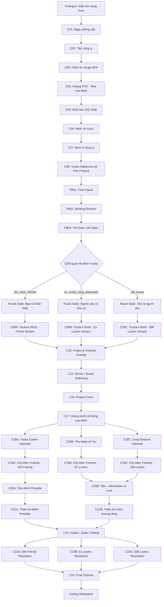
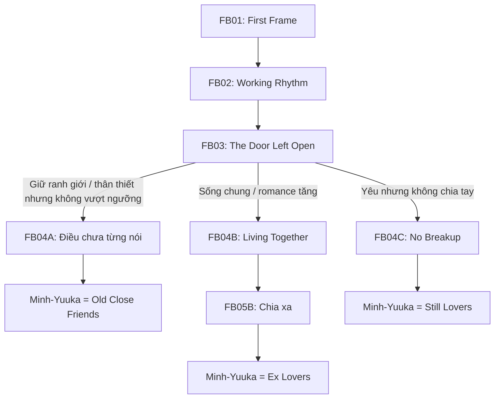
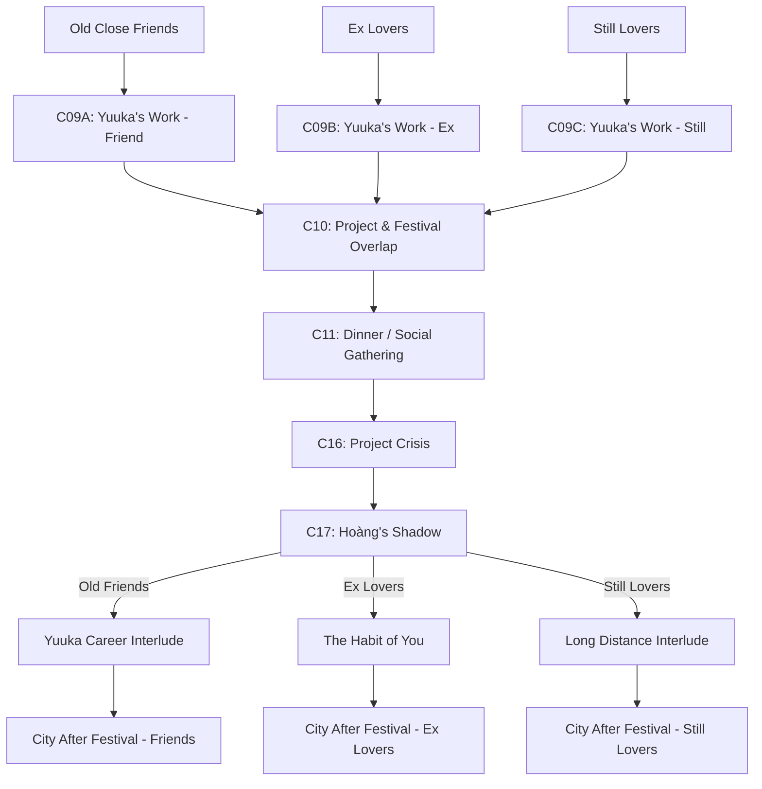
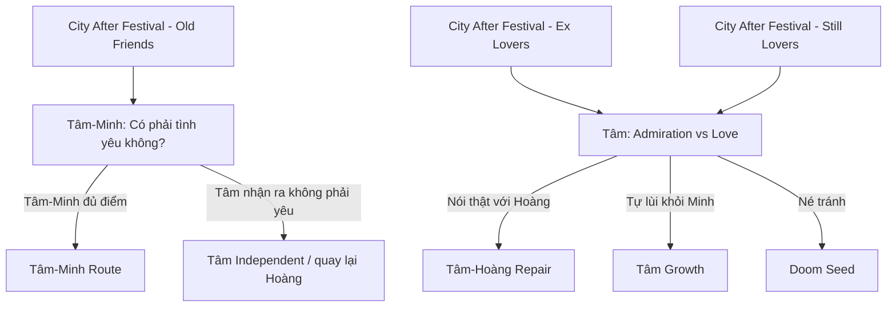
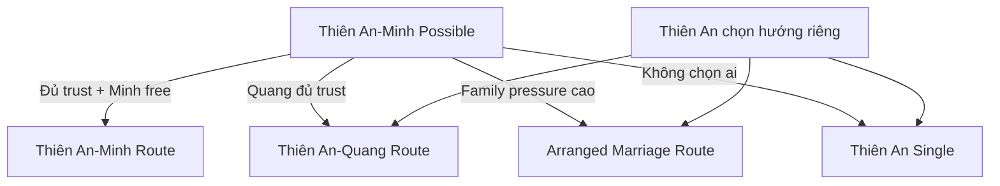
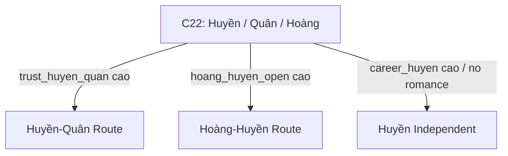
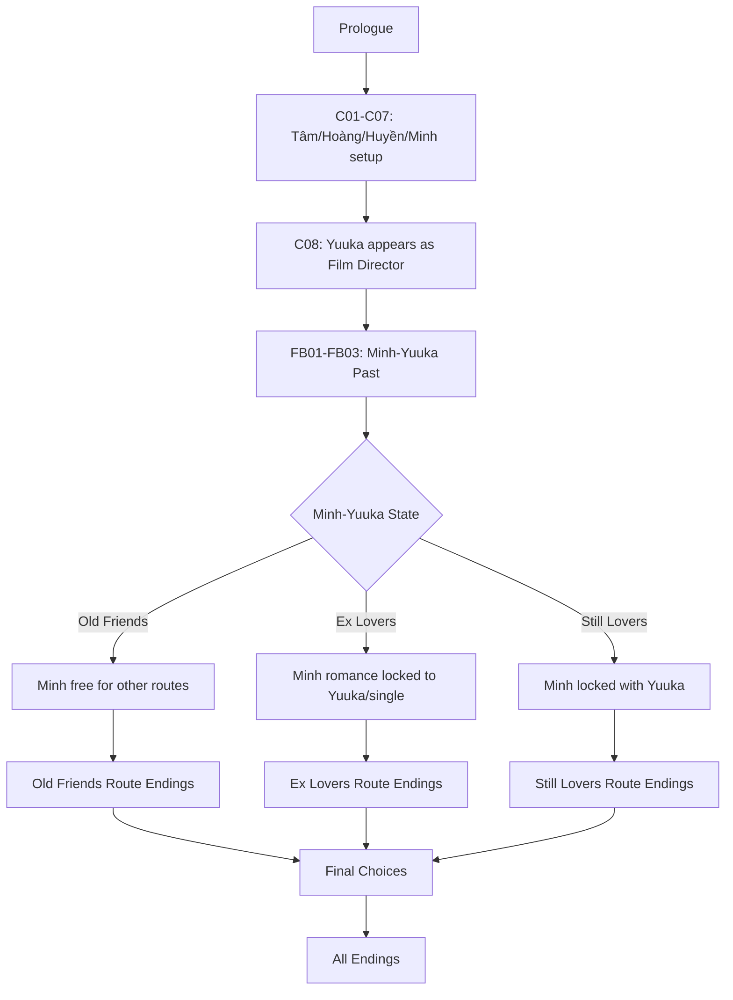

# 1. Legend

```text
Cxx  = Main Chapter
FBxx = Flashback Chapter
R    = Relationship State
E    = Ending
```

Core rule lớn nhất:

```text
Nếu Minh-Yuuka = Ex Lovers hoặc Still Lovers
→ khóa toàn bộ romance pairing khác của Minh.
→ Minh chỉ còn các ending với Yuuka hoặc độc thân.
```

---

# 2. Timeline Flow tổng thể



---

# 3. Branch chính theo chương

## Prologue → C01

```text
Prologue: Tâm mơ về Minh trong mưa
→ C01 luôn mở.
```

Possible flags:

```text
tam_minh_drawn
tam_grounded
huyen_tease_dream
```

---

## C01 → C02

```text
C01: Tâm & Huyền phỏng vấn, trúng tuyển, ăn mừng
→ C02: Tiệc công ty.
```

Possible branches:

```text
Tâm để ý Hoàng
Huyền để ý Hoàng
Tâm tập trung career
Tâm-Huyền bond tăng
```

---

## C02 → C03

```text
C02: Tâm/Huyền gặp Hoàng tại tiệc công ty
→ C03: Thiên An và gia đình.
```

Possible branches:

```text
Tâm chủ động làm quen Hoàng
Hoàng chủ động làm quen Tâm
Không ai chủ động, chỉ là xã giao
Huyền tương tác với Hoàng nhiều hơn
```

---

## C03 → C04

```text
C03: Giới thiệu Thiên An, áp lực gia đình, career seed cho Tâm
→ Unlock Hoàng POV
→ C04.
```

Possible branches:

```text
Tâm học quản lý dự án
Tâm thân hơn với Thiên An
Tâm biết hint quá khứ Thiên An-Minh
Thiên An chịu thêm family pressure
```

---

## C04 → C05

```text
C04: Hoàng sống ở nhà Minh, hỏi Minh chọn quà
→ C05: Buổi hẹn Chủ Nhật.
```

Gift branch:

```text
Nếu Tâm-Hoàng open → quà cho Tâm
Nếu Hoàng-Huyền open → quà cho Huyền
Nếu chưa romance → quà / hoạt động nhóm
Nếu chọn sai → awkward gift scene
```

---

## C05 → C06

```text
C05: Buổi hẹn Chủ Nhật
→ C06: Minh về nước.
```

Branch:

```text
Tâm-Hoàng date riêng
Hoàng-Huyền date riêng
Ba người đi chơi nhóm
```

Result:

```text
Tâm-Hoàng commit
Hoàng-Huyền open
Friend group route
```

---

## C06 → C07

```text
C06: Minh về nước
→ Unlock Minh Route
→ C07: Minh ở công ty.
```

Branch:

```text
Nếu Tâm-Hoàng canon → Tâm gặp Minh, bị lệch nhịp
Nếu Hoàng-Huyền → Huyền gặp Minh trước, kéo Tâm vào bữa tối sau
Nếu friend route → Hoàng giới thiệu Tâm/Huyền với Minh như bạn công việc
```

---

## C07 → C08

```text
C07: Minh làm cố vấn dự án
→ C08: Yuuka xuất hiện tại Film Festival.
```

Branch:

```text
Tâm POV: cảm giác với Minh / giữ khoảng cách / tập trung công việc
Minh POV: quan sát team / giữ boundary / hỗ trợ chuyên môn
```

---

# 4. Chương 8 mới — node trung tính

## C08 — Yuuka Nakamura

```text
Yuuka được giới thiệu là đạo diễn trẻ người Nhật.
Trọng tâm: Film Festival, sự nghiệp, phong cách làm phim.
Quan hệ với Minh/Hoàng chỉ được giới thiệu trung tính:
“Bạn cũ của Minh và Hoàng.”
```

Không xác nhận:

```text
Không nói người yêu cũ.
Không nói vẫn yêu.
Không nói tình cũ chưa quên.
```

C08 unlock:

```text
FB01: First Frame
FB02: Working Rhythm
FB03: The Door Left Open
```

---

# 5. Flashback định hình Minh-Yuuka



---

# 6. Relationship State sau Flashback

## R1 — Old Close Friends

```text
Minh-Yuuka = bạn cũ thân thiết.
Có thể từng có rung động.
Chưa từng là người yêu chính thức.
Không khóa romance khác của Minh.
```

Unlock:

```text
Tâm-Minh possible
Thiên An-Minh possible
Minh độc thân
Yuuka độc thân / career
Minh-Yuuka friendship ending
```

---

## R2 — Ex Lovers Long Separated

```text
Minh-Yuuka = người yêu cũ, chia xa nhiều năm.
Minh vẫn yêu sâu.
Yuuka vẫn còn vết thương.
```

Lock:

```text
Khóa Minh-Tâm.
Khóa Minh-Thiên An.
Khóa mọi pairing khác của Minh.
```

Unlock:

```text
Minh-Yuuka quay lại
Minh-Yuuka đến với nhau nhiều năm sau
Minh độc thân
Yuuka độc thân
Cả hai độc thân
Doom unresolved
```

---

## R3 — Still Lovers

```text
Minh-Yuuka = vẫn là người yêu.
Xa nhau vì hoàn cảnh / sự nghiệp / trách nhiệm.
Không có breakup thật sự.
```

Lock:

```text
Khóa Minh-Tâm.
Khóa Minh-Thiên An.
Khóa Minh độc thân thật sự.
Khóa Yuuka độc thân thật sự.
```

Unlock:

```text
Minh-Yuuka private lovers
Minh-Yuuka public lovers
Minh-Yuuka non-marriage lovers
Minh-Yuuka long-distance lovers
```

---

# 7. Flow sau Chương 9 theo từng state



---

# 8. Route đặc biệt của Tâm-Minh



Rule:

```text
Tâm-Minh chỉ mở nếu:
Minh-Yuuka = Old Close Friends.
```

---

# 9. Route đặc biệt của Thiên An-Minh



Rule:

```text
Thiên An-Minh chỉ mở nếu:
Minh-Yuuka = Old Close Friends.
```

---

# 10. Huyền Route



---

# 11. Final Route Resolution

```mermaid
flowchart TD
    C24[Final Choices] --> ECheck{Ending Resolution}

    ECheck --> E01[Canon True Ending]
    ECheck --> E02[Tâm-Hoàng Ending]
    ECheck --> E03[Tâm-Minh Ending]
    ECheck --> E04[Hoàng-Huyền Ending]
    ECheck --> E05[Huyền-Quân Ending]
    ECheck --> E06[Thiên An-Quang Ending]
    ECheck --> E07[Thiên An-Minh Ending]
    ECheck --> E08[Thiên An Single Ending]
    ECheck --> E09[Thiên An Arranged Marriage Ending]
    ECheck --> E10[Minh-Yuuka Reunion Ending]
    ECheck --> E11[Minh-Yuuka Late Reunion Ending]
    ECheck --> E12[Minh-Yuuka Still Lovers Private Ending]
    ECheck --> E13[Minh-Yuuka Still Lovers Public Ending]
    ECheck --> E14[Minh-Yuuka Non-Marriage Ending]
    ECheck --> E15[Minh-Yuuka Long-Distance Ending]
    ECheck --> E16[Minh Single Ending]
    ECheck --> E17[Yuuka Single Ending]
    ECheck --> E18[Mutual Single Minh-Yuuka Ending]
    ECheck --> E19[Yuuka Career Ending]
    ECheck --> E20[Friendship Ending Minh-Yuuka]
    ECheck --> E21[Tâm Independent Ending]
    ECheck --> E22[Huyền Independent Ending]
    ECheck --> E23[Hoàng Single Growth Ending]
    ECheck --> E24[Doom Ending]
```



---

# 12. Toàn bộ Possible Endings

## E01 — Canon True Ending

```text
Tâm - Hoàng
Minh - Yuuka quay lại
Huyền - Quân
Thiên An - Quang
```

Required:

```text
Tâm-Hoàng stable
Minh-Yuuka = Ex Lovers hoặc Still Lovers
Minh-Yuuka resolved tốt
Huyền-Quân đủ trust
Thiên An-Quang đủ trust
Doom score thấp
```

---

## E02 — Tâm-Hoàng Ending

```text
Tâm và Hoàng chọn nhau.
Minh-Yuuka không chen vào tuyến Tâm.
Hoàng vượt qua insecurity.
Tâm hiểu khác biệt giữa rung động, ngưỡng mộ và tình yêu.
```

---

## E03 — Tâm-Minh Ending

```text
Tâm và Minh đến với nhau.
```

Required:

```text
Minh-Yuuka = Old Close Friends
Tâm-Hoàng không commit / đã break sạch
trust_tam_minh cao
Minh không romance-lock
```

Blocked:

```text
Minh-Yuuka = Ex Lovers
Minh-Yuuka = Still Lovers
```

---

## E04 — Hoàng-Huyền Ending

```text
Hoàng và Huyền thành đôi.
```

Required:

```text
Hoàng-Huyền open
Tâm-Hoàng không commit
Huyền-Quân không lock
trust_hoang_huyen cao
```

---

## E05 — Huyền-Quân Ending

```text
Huyền và Quân thành đôi.
```

Required:

```text
trust_huyen_quan cao
Huyền không lock Hoàng
Quân respect Huyền sau project crisis
```

---

## E06 — Thiên An-Quang Ending

```text
Thiên An chọn Quang.
```

Required:

```text
trust_thienan_quang cao
family_pressure không thắng
Thiên An tự chọn đời sống thật, không chọn theo áp lực
```

---

## E07 — Thiên An-Minh Ending

```text
Thiên An và Minh đến với nhau.
```

Required:

```text
Minh-Yuuka = Old Close Friends
Tâm-Minh không lock
thienan_minh_residue cao
trust_minh_thienan cao
Quang route không lock
```

Blocked:

```text
Minh-Yuuka = Ex Lovers
Minh-Yuuka = Still Lovers
```

---

## E08 — Thiên An Single Ending

```text
Thiên An không chọn ai.
Cô giữ quyền tự quyết và sống theo trục riêng.
```

Required:

```text
self_assertion_thienan cao
trust_thienan_quang thấp hoặc không đủ
family_pressure bị chống lại thành công
```

---

## E09 — Thiên An Arranged Marriage Ending

```text
Thiên An kết hôn theo sắp xếp gia đình.
```

Required:

```text
family_pressure_thienan cao
trust_thienan_quang thấp
self_assertion_thienan thấp
Minh route không mở
```

Tone:

```text
Đẹp bề mặt, lạnh bên trong.
```

---

## E10 — Minh-Yuuka Reunion Ending

```text
Minh và Yuuka quay lại với nhau.
```

Required:

```text
Minh-Yuuka = Ex Lovers
trust_minh_yuuka cao
unresolved_past giảm đủ
Yuuka không chạy nữa
Minh hạ boundary
```

---

## E11 — Minh-Yuuka Late Reunion Ending

```text
Minh và Yuuka không quay lại ngay.
Nhiều năm sau mới đến với nhau.
```

Required:

```text
Minh-Yuuka = Ex Lovers
late_reunion_possible
trust còn đủ
distance vẫn còn nhưng không cắt đứt
cả hai không chọn người khác
```

---

## E12 — Still Lovers Private Ending

```text
Minh và Yuuka vẫn là người yêu, nhưng giữ kín.
```

Required:

```text
Minh-Yuuka = Still Lovers
private_lovers choice
Yuuka chấp nhận quan hệ kín
Minh giữ được sự an toàn cho cả hai
```

---

## E13 — Still Lovers Public Ending

```text
Minh và Yuuka công khai hơn với nhóm thân thiết.
```

Required:

```text
Minh-Yuuka = Still Lovers
public_lovers choice
trust_minh_yuuka cao
external pressure thấp
```

---

## E14 — Non-Marriage Lovers Ending

```text
Minh và Yuuka chọn nhau lâu dài nhưng không kết hôn.
```

Required:

```text
Minh-Yuuka = Ex Lovers hoặc Still Lovers
non_marriage_choice
cả hai ưu tiên tự do / sự nghiệp / đời sống riêng
trust cao
```

---

## E15 — Long-Distance Lovers Ending

```text
Minh và Yuuka tiếp tục yêu xa.
```

Required:

```text
Minh-Yuuka = Still Lovers
Yuuka career priority cao
Minh support cao
không chọn public/full domestic ending
```

---

## E16 — Minh Single Ending

```text
Minh độc thân.
```

Allowed nếu:

```text
Minh-Yuuka = Old Close Friends
hoặc Minh-Yuuka = Ex Lovers
```

Blocked nếu:

```text
Minh-Yuuka = Still Lovers
```

Nếu Ex Lovers:

```text
Minh không quay lại Yuuka, nhưng cũng không mở lòng với ai khác.
```

---

## E17 — Yuuka Single Ending

```text
Yuuka độc thân.
```

Allowed nếu:

```text
Minh-Yuuka = Old Close Friends
hoặc Minh-Yuuka = Ex Lovers
```

Blocked nếu:

```text
Minh-Yuuka = Still Lovers
```

Nếu Ex Lovers:

```text
Yuuka không chạy nữa, nhưng chọn sống tiếp một mình.
```

---

## E18 — Mutual Single Minh-Yuuka Ending

```text
Minh và Yuuka tha thứ / hiểu nhau,
nhưng không quay lại.
Cả hai đều độc thân.
```

Required:

```text
Minh-Yuuka = Ex Lovers
mutual_single choice
trust đủ để tha thứ
intimacy không đủ để reunion
```

---

## E19 — Yuuka Career Ending

```text
Yuuka chọn sự nghiệp.
```

Required:

```text
career_yuuka cao
Yuuka không romance-lock hoặc chọn career-first
Minh-Yuuka = Old Close Friends hoặc Ex Lovers
```

---

## E20 — Minh-Yuuka Friendship Ending

```text
Minh và Yuuka giữ lại tình bạn cũ.
```

Required:

```text
Minh-Yuuka = Old Close Friends
romantic_score thấp / medium
trust_minh_yuuka cao
```

---

## E21 — Tâm Independent Ending

```text
Tâm không chọn Hoàng hoặc Minh.
Cô trưởng thành qua công việc và hiểu rõ cảm xúc của mình.
```

Required:

```text
career_tam cao
tam_self_clarity cao
romance routes không lock
```

---

## E22 — Huyền Independent Ending

```text
Huyền không chọn Hoàng hoặc Quân.
Tập trung sự nghiệp / đời sống riêng.
```

Required:

```text
career_huyen cao
huyen_quan không đủ trust
hoang_huyen không lock
```

---

## E23 — Hoàng Single Growth Ending

```text
Hoàng không thành đôi.
Nhưng vượt qua cái bóng của Minh và tự đứng bằng giá trị riêng.
```

Required:

```text
hoang_self_acceptance cao
Tâm không chọn Hoàng
Huyền không chọn Hoàng
doom_score thấp
```

---

## E24 — Doom Ending

```text
Không ai trong dàn chính thành đôi.
```

Possible causes:

```text
trust các cặp thấp
avoidance_minh cao
avoidance_yuuka cao
Tâm né cảm xúc
Hoàng insecurity unresolved
Thiên An family pressure cao
Huyền không đủ trust với Quân/Hoàng
```

Biến thể đặc biệt:

```text
Nếu Minh-Yuuka = Ex Lovers
nhưng không đủ điểm reunion / late reunion / mutual single tử tế
→ Minh và Yuuka đều mắc kẹt trong unresolved past.
→ kéo doom_score rất mạnh.
```

Tone:

```text
Ai cũng sống tiếp.
Ai cũng có vẻ ổn.
Không ai nói đúng câu cần nói.
```

---

# 13. Diagram rút gọn cực ngắn



---

# 14. Implementation note ngắn

Trong metadata nên có 3 node khóa:

```text
minh_yuuka_relation_unknown
minh_yuuka_relation_old_close_friends
minh_yuuka_relation_ex_lovers
minh_yuuka_relation_still_lovers
```

Và một hard rule:

```text
if minh_yuuka_relation in ["ex_lovers", "still_lovers"]:
    exclude:
    - tam_minh_commit
    - thienan_minh_commit
    - any_minh_other_romance
```

Cái này là xương sống của diagram. Không có nó, route Minh sẽ bị “mở lung tung” và phá canon nhân vật khá nặng.
