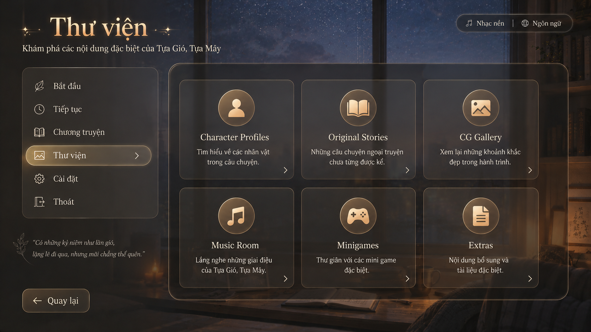

# Technical Implementation Document

## Library Screen UI Design— *Tựa Gió, Tựa Mây*



## 1. Purpose

Implement a new **Library / Thư viện** screen for the Ren’Py game.

The Library screen allows players to access unlocked and optional content:

* Character Profiles
* Original Stories
* CG Gallery
* Music Room
* Minigames
* Extras / Bonus Materials

The screen must visually match the existing Main Menu and Tâm’s Speech minigame style:

* warm cinematic tone;
* soft gold accents;
* semi-transparent dark panels;
* elegant serif typography for titles;
* simple card-based navigation;
* minimal decorative elements;
* usable without custom image assets whenever possible.

The Library screen should feel like an extension of the Main Menu, not a separate system.

---

# 2. Target Screen Behavior

## Entry Point

From the Main Menu:

```renpy
textbutton _("Thư viện") action ShowMenu("library")
```

or, if using English UI:

```renpy
textbutton _("Library") action ShowMenu("library")
```

## Exit Behavior

The Library screen should return to Main Menu:

```renpy
textbutton _("Back") action ShowMenu("main_menu")
```

Escape / right-click should also return to the previous menu or main menu:

```renpy
key "game_menu" action ShowMenu("main_menu")
key "K_ESCAPE" action ShowMenu("main_menu")
```

---

# 3. Visual Design Requirements

## Overall Style

Use the same background as Main Menu.

Recommended:

```renpy
add main_menu_background
```

or:

```renpy
add "gui/main_menu/background.png"
```

Fallback:

```renpy
add Solid("#15110f")
```

The background should be dimmed slightly so the Library UI remains readable.

```renpy
add Solid("#00000066")
```

Use warm gold and soft beige as the primary accent colors.

Suggested palette:

```renpy
define LIB_COLOR_TEXT = "#F5E8D0"
define LIB_COLOR_MUTED = "#C9B89A"
define LIB_COLOR_GOLD = "#E8C27A"
define LIB_COLOR_GOLD_SOFT = "#B98A4A"
define LIB_COLOR_PANEL = "#16120FCC"
define LIB_COLOR_PANEL_SOFT = "#211A16AA"
define LIB_COLOR_BORDER = "#C99B5F"
define LIB_COLOR_DISABLED = "#8A8173"
```

---

# 4. Layout Specification

Target resolution: **1920x1080**

The implementation should be PC-first.

## Main Regions

### 4.1 Header

Position:

```text
x = 72
y = 58
```

Content:

```text
Title: Library / Thư viện
Subtitle: Explore special contents of Tựa Gió, Tựa Mây
```

Suggested sizes:

```text
Title font size: 72
Subtitle font size: 28
```

Use the same serif font style as Main Menu title.

---

### 4.2 Top Right Utility Bar

Same as Main Menu.

Position:

```text
xalign = 0.96
y = 42
width ≈ 380
height ≈ 58
```

Contains:

```text
♪ Music
|
🌐 Language
```

Actions may be connected later. For now, they can use placeholder actions:

```renpy
textbutton _("Music") action NullAction()
textbutton _("Language") action ShowMenu("preferences")
```

---

### 4.3 Left Navigation Panel

This should visually match the Main Menu sidebar.

Position:

```text
x = 72
y = 225
width = 460
height = 505
```

Items:

```text
Start
Continue
Route Map / Chapters
Library
Settings
Exit
```

The Library item must be highlighted.

Recommended actions:

```renpy
Start      -> Start()
Continue   -> Continue()
Route Map  -> ShowMenu("route_map") or Jump("route_map")
Library    -> NullAction()
Settings   -> ShowMenu("preferences")
Exit       -> Quit(confirm=True)
```

Important:

* Do not make the Library sidebar too complex.
* Keep it close to Main Menu.
* The current active item should have a warm gold glow / highlighted background.

---

### 4.4 Main Content Panel

Position:

```text
x = 560
y = 210
width = 1290
height = 760
```

Style:

```text
semi-transparent dark panel
thin gold border
large rounded corners if assets exist
soft inner padding
```

If rounded frame assets are not available, use a rectangular `Frame` or `Solid` fallback.

---

### 4.5 Library Cards

Use a 3-column x 2-row grid.

Cards:

```text
1. Character Profiles
2. Original Stories
3. CG Gallery
4. Music Room
5. Minigames
6. Extras
```

Recommended card size:

```text
width = 360–390
height = 260–285
gap = 28–32
```

Each card contains:

```text
Icon
Title
Short description
Arrow indicator
Optional unlocked count
```

Example:

```text
Character Profiles
Learn about the characters in the story.
12 / 18 unlocked
```

Card should be clickable.

Hover behavior:

* slightly brighter background;
* gold border stronger;
* title color becomes gold;
* optional scale 1.01 or 1.02 only if it does not jitter.

Locked state:

* lower opacity;
* title muted;
* show lock marker;
* action should be `NullAction()` or disabled.

---

# 5. File Structure

Create these files:

```text
game/screens/library_screen.rpy
game/screens/library_subscreens.rpy
game/data/library_data.rpy
game/styles/library_styles.rpy
game/tl/vietnamese/library_screen.rpy
```

If the project does not use folders for screens/styles/data, use:

```text
game/library_screen.rpy
game/library_subscreens.rpy
game/library_data.rpy
game/library_styles.rpy
```

Keep the implementation isolated. Do not overload `screens.rpy` unless the current project convention requires it.

---

# 6. Library Data Model

Create `library_data.rpy`.

```renpy
init python:
    LIBRARY_CATEGORIES = [
        {
            "id": "characters",
            "title": _("Character Profiles"),
            "subtitle": _("Learn about the characters in the story."),
            "icon_text": "👤",
            "screen": "library_characters",
            "requires_unlock": False,
        },
        {
            "id": "stories",
            "title": _("Original Stories"),
            "subtitle": _("Read side stories and original materials."),
            "icon_text": "📖",
            "screen": "library_stories",
            "requires_unlock": False,
        },
        {
            "id": "cg",
            "title": _("CG Gallery"),
            "subtitle": _("Review memorable visual moments."),
            "icon_text": "▧",
            "screen": "library_cg",
            "requires_unlock": False,
        },
        {
            "id": "music",
            "title": _("Music Room"),
            "subtitle": _("Listen to unlocked music tracks."),
            "icon_text": "♪",
            "screen": "library_music",
            "requires_unlock": False,
        },
        {
            "id": "minigames",
            "title": _("Minigames"),
            "subtitle": _("Replay special minigames."),
            "icon_text": "🎮",
            "screen": "library_minigames",
            "requires_unlock": False,
        },
        {
            "id": "extras",
            "title": _("Extras"),
            "subtitle": _("Bonus content and special materials."),
            "icon_text": "✦",
            "screen": "library_extras",
            "requires_unlock": False,
        },
    ]

    def library_category_is_unlocked(category_id):
        # Default: all categories visible.
        # Later this can check persistent flags.
        return True

    def library_get_progress_text(category_id):
        # Optional placeholder.
        # Replace with real unlock counts later.
        progress_map = {
            "characters": "0 / 0",
            "stories": "0 / 0",
            "cg": "0 / 0",
            "music": "0 / 0",
            "minigames": "0 / 0",
            "extras": "0 / 0",
        }
        return progress_map.get(category_id, "")
```

Note: emoji icons may not render depending on the selected font. If the font does not support them, replace with plain symbols or image icons later.

---

# 7. Asset Fallback Strategy

The screen should work even if UI image assets are missing.

Create helper functions:

```renpy
init python:
    def ui_image_or_solid(path, color):
        if renpy.loadable(path):
            return path
        return Solid(color)

    def ui_frame_or_solid(path, color, border=24):
        if renpy.loadable(path):
            return Frame(path, border, border)
        return Solid(color)
```

Recommended optional assets:

```text
gui/library/panel.png
gui/library/card_idle.png
gui/library/card_hover.png
gui/library/sidebar_panel.png
gui/library/sidebar_item_idle.png
gui/library/sidebar_item_hover.png
gui/library/sidebar_item_selected.png
```

If those assets do not exist, use `Solid()` fallback.

Important:

Ren’Py does not provide perfect rounded translucent panels without image assets in the usual screen language workflow. For accurate rounded corners and borders, use small 9-slice PNG frame assets. For fallback, rectangular panels are acceptable.

---

# 8. Styles

Create `library_styles.rpy`.

```renpy
init -2:
    define LIB_TEXT = "#F5E8D0"
    define LIB_MUTED = "#C9B89A"
    define LIB_GOLD = "#E8C27A"
    define LIB_GOLD_DARK = "#B98A4A"
    define LIB_PANEL = "#16120FCC"
    define LIB_PANEL_SOFT = "#211A16AA"
    define LIB_PANEL_HOVER = "#33261BCC"
    define LIB_DISABLED = "#8A8173"

style library_title_text:
    color LIB_TEXT
    size 72
    font gui.interface_text_font
    outlines [(1, "#5A3A1A99", 0, 0)]

style library_subtitle_text:
    color LIB_TEXT
    size 28
    font gui.interface_text_font

style library_sidebar_text:
    color LIB_TEXT
    hover_color LIB_GOLD
    insensitive_color LIB_DISABLED
    size 28
    font gui.interface_text_font

style library_card_title:
    color LIB_TEXT
    hover_color LIB_GOLD
    size 30
    text_align 0.5
    font gui.interface_text_font

style library_card_subtitle:
    color LIB_MUTED
    size 22
    text_align 0.5
    line_spacing 4
    font gui.interface_text_font

style library_card_progress:
    color LIB_GOLD
    size 18
    text_align 0.5
    font gui.interface_text_font

style library_back_button_text:
    color LIB_TEXT
    hover_color LIB_GOLD
    size 28
    font gui.interface_text_font
```

If the project already has custom title fonts, replace `gui.interface_text_font` with the existing title / serif font.

---

# 9. Main Library Screen

Create `library_screen.rpy`.

```renpy
screen library():

    tag menu

    # Background
    if renpy.loadable("gui/main_menu/background.png"):
        add "gui/main_menu/background.png"
    else:
        add Solid("#15110f")

    # Dim overlay
    add Solid("#00000066")

    # Header
    vbox:
        xpos 72
        ypos 58
        spacing 6

        text _("Thư viện") style "library_title_text"
        text _("Khám phá các nội dung đặc biệt của Tựa Gió, Tựa Mây") style "library_subtitle_text"

    # Top right utility bar
    frame:
        xalign 0.96
        ypos 42
        xsize 380
        ysize 58
        background ui_frame_or_solid("gui/library/top_chip.png", "#1A1511AA", 24)

        hbox:
            xalign 0.5
            yalign 0.5
            spacing 22

            textbutton _("♪  Nhạc nền"):
                action NullAction()
                text_style "library_sidebar_text"

            text "|":
                color "#C9B89A88"
                size 24

            textbutton _("◎  Ngôn ngữ"):
                action ShowMenu("preferences")
                text_style "library_sidebar_text"

    # Sidebar
    frame:
        xpos 72
        ypos 225
        xsize 460
        ysize 505
        padding (22, 24)
        background ui_frame_or_solid("gui/library/sidebar_panel.png", "#18130FCC", 28)

        vbox:
            spacing 8

            use library_sidebar_item(_("Bắt đầu"), "leaf", Start(), False)
            use library_sidebar_item(_("Tiếp tục"), "clock", Continue(), False)
            use library_sidebar_item(_("Chương truyện"), "book", ShowMenu("route_map"), False)
            use library_sidebar_item(_("Thư viện"), "image", NullAction(), True)
            use library_sidebar_item(_("Cài đặt"), "gear", ShowMenu("preferences"), False)
            use library_sidebar_item(_("Thoát"), "exit", Quit(confirm=True), False)

    # Flavor quote
    vbox:
        xpos 72
        ypos 805
        spacing 4

        text "“Có những kỷ niệm như làn gió,":
            color "#D8C9AD"
            size 24
            italic True

        text "lặng lẽ đi qua, nhưng mãi chẳng thể quên.”":
            color "#D8C9AD"
            size 24
            italic True

    # Back button
    textbutton _("←  Quay lại"):
        xpos 72
        ypos 970
        xsize 220
        ysize 68
        action ShowMenu("main_menu")
        text_style "library_back_button_text"
        background ui_frame_or_solid("gui/library/back_button_idle.png", "#211A16CC", 24)
        hover_background ui_frame_or_solid("gui/library/back_button_hover.png", "#3A2A1BCC", 24)

    # Main content panel
    frame:
        xpos 560
        ypos 210
        xsize 1290
        ysize 760
        padding (36, 36)
        background ui_frame_or_solid("gui/library/content_panel.png", "#15110FCC", 32)

        grid 3 2:
            spacing 28
            xalign 0.5
            yalign 0.5

            for category in LIBRARY_CATEGORIES:
                use library_category_card(category)

    key "K_ESCAPE" action ShowMenu("main_menu")
    key "game_menu" action ShowMenu("main_menu")
```

---

# 10. Sidebar Item Component

```renpy
screen library_sidebar_item(label, icon_id, action_value, selected=False):

    $ bg_idle = "gui/library/sidebar_item_selected.png" if selected else "gui/library/sidebar_item_idle.png"
    $ bg_hover = "gui/library/sidebar_item_selected.png" if selected else "gui/library/sidebar_item_hover.png"

    button:
        xsize 410
        ysize 58
        action action_value
        background ui_frame_or_solid(bg_idle, "#211A16AA" if selected else "#00000000", 22)
        hover_background ui_frame_or_solid(bg_hover, "#5A3A1A99", 22)

        hbox:
            xalign 0.0
            yalign 0.5
            spacing 22

            text library_icon_text(icon_id):
                size 28
                color LIB_GOLD if selected else LIB_TEXT

            text label:
                style "library_sidebar_text"
                color LIB_GOLD if selected else LIB_TEXT
```

Add icon helper:

```renpy
init python:
    def library_icon_text(icon_id):
        icons = {
            "leaf": "◇",
            "clock": "◷",
            "book": "▤",
            "image": "▧",
            "gear": "⚙",
            "exit": "⇱",
        }
        return icons.get(icon_id, "•")
```

---

# 11. Library Category Card Component

```renpy
screen library_category_card(category):

    $ cid = category["id"]
    $ unlocked = library_category_is_unlocked(cid)
    $ progress_text = library_get_progress_text(cid)
    $ target_screen = category["screen"]

    button:
        xsize 375
        ysize 285
        sensitive unlocked
        action ShowMenu(target_screen) if unlocked else NullAction()

        background ui_frame_or_solid("gui/library/card_idle.png", "#211A16AA", 28)
        hover_background ui_frame_or_solid("gui/library/card_hover.png", "#3A2A1BCC", 28)
        insensitive_background ui_frame_or_solid("gui/library/card_locked.png", "#15110F99", 28)

        vbox:
            xalign 0.5
            yalign 0.5
            spacing 16

            frame:
                xalign 0.5
                xsize 96
                ysize 96
                background ui_frame_or_solid("gui/library/icon_circle.png", "#6A4827AA", 48)

                text category["icon_text"]:
                    xalign 0.5
                    yalign 0.5
                    size 46
                    color LIB_TEXT if unlocked else LIB_DISABLED

            text category["title"]:
                style "library_card_title"
                xalign 0.5
                color LIB_TEXT if unlocked else LIB_DISABLED

            text category["subtitle"]:
                style "library_card_subtitle"
                xalign 0.5
                xmaximum 310
                color LIB_MUTED if unlocked else LIB_DISABLED

            if progress_text:
                text progress_text:
                    style "library_card_progress"
                    xalign 0.5
                    color LIB_GOLD if unlocked else LIB_DISABLED

        text "›":
            xpos 338
            ypos 232
            size 36
            color LIB_GOLD if unlocked else LIB_DISABLED
```

---

# 12. Child Screens

Create placeholder child screens first. These should be functional enough for navigation and later expansion.

## 12.1 Character Profiles

```renpy
screen library_characters():

    tag menu
    use library_base_subscreen(_("Character Profiles"), _("Learn more about each character."))

    frame:
        xpos 560
        ypos 220
        xsize 1290
        ysize 730
        padding (36, 36)
        background ui_frame_or_solid("gui/library/content_panel.png", "#15110FCC", 32)

        text _("Character profile system will be implemented here."):
            color LIB_TEXT
            size 28
            xalign 0.5
            yalign 0.5
```

Recommended final layout:

```text
Left: character list
Right: portrait + biography + relationship notes
```

Data model later:

```renpy
CHARACTER_PROFILES = [
    {
        "id": "tam",
        "name": _("Tâm"),
        "route": "tam",
        "portrait": "images/profiles/tam.png",
        "description": _("A gentle young woman with quiet emotional strength."),
        "unlock_flag": "profile_tam",
    },
]
```

---

## 12.2 Original Stories

Purpose:

* read original text chapters;
* side stories;
* draft materials;
* unlocked bonus scenes.

Recommended layout:

```text
Left: story list
Right: title, description, read button
```

Action:

```renpy
ShowMenu("library_story_reader", story_id)
```

---

## 12.3 CG Gallery

Purpose:

* display unlocked CG images;
* show thumbnails;
* open fullscreen preview.

Recommended layout:

```text
Scrollable thumbnail grid
Locked thumbnails shown as dark placeholders
```

Example action:

```renpy
ShowMenu("library_cg_viewer", cg_id)
```

Persistent unlock:

```renpy
default persistent.unlocked_cg = set()
```

Use helper:

```renpy
init python:
    def unlock_cg(cg_id):
        if persistent.unlocked_cg is None:
            persistent.unlocked_cg = set()
        persistent.unlocked_cg.add(cg_id)
        renpy.save_persistent()
```

---

## 12.4 Music Room

Purpose:

* play unlocked tracks;
* preview OST / BGM.

Recommended layout:

```text
Track list
Track title
Play / Stop buttons
```

Actions:

```renpy
Play("music", track_path)
Stop("music")
```

---

## 12.5 Minigames

Purpose:

* replay unlocked minigames;
* show score / completion status.

Example items:

```text
Tâm’s Speech
Timeline Review
Interview Prep
```

Action examples:

```renpy
Jump("tam_c01_speech_game")
ShowMenu("speech_minigame_replay")
```

Important:

Do not jump directly into story-affecting versions of minigames unless replay mode is safe. Prefer separate replay labels that do not modify main progression.

---

## 12.6 Extras

Purpose:

* bonus materials;
* concept notes;
* endings archive;
* system glossary;
* developer notes.

Recommended layout:

```text
Simple list of bonus entries
```

---

# 13. Shared Subscreen Base

Create this helper screen so all child Library screens stay visually consistent.

```renpy
screen library_base_subscreen(title, subtitle=""):

    if renpy.loadable("gui/main_menu/background.png"):
        add "gui/main_menu/background.png"
    else:
        add Solid("#15110f")

    add Solid("#00000066")

    vbox:
        xpos 72
        ypos 58
        spacing 6

        text title style "library_title_text"

        if subtitle:
            text subtitle style "library_subtitle_text"

    textbutton _("←  Thư viện"):
        xpos 72
        ypos 970
        xsize 240
        ysize 68
        action ShowMenu("library")
        text_style "library_back_button_text"
        background ui_frame_or_solid("gui/library/back_button_idle.png", "#211A16CC", 24)
        hover_background ui_frame_or_solid("gui/library/back_button_hover.png", "#3A2A1BCC", 24)

    key "K_ESCAPE" action ShowMenu("library")
    key "game_menu" action ShowMenu("library")
```

---

# 14. Unlock Integration

The first implementation may show all Library categories unlocked.

Later, use persistent flags:

```renpy
default persistent.library_unlocked_categories = {
    "characters": True,
    "stories": True,
    "cg": True,
    "music": True,
    "minigames": True,
    "extras": True,
}
```

Helper:

```renpy
init python:
    def unlock_library_category(category_id):
        if persistent.library_unlocked_categories is None:
            persistent.library_unlocked_categories = {}
        persistent.library_unlocked_categories[category_id] = True
        renpy.save_persistent()

    def library_category_is_unlocked(category_id):
        if persistent.library_unlocked_categories is None:
            return True
        return persistent.library_unlocked_categories.get(category_id, True)
```

When completing story chapters:

```renpy
$ unlock_library_category("cg")
$ unlock_cg("tam_interview_cg_01")
```

For minigames:

```renpy
$ unlock_library_category("minigames")
$ persistent.unlocked_minigames.add("tam_speech")
```

---

# 15. Localization

Add translations using `_()` around all user-facing strings.

Example Vietnamese file:

```renpy
translate vietnamese strings:

    old "Library"
    new "Thư viện"

    old "Character Profiles"
    new "Hồ sơ nhân vật"

    old "Original Stories"
    new "Truyện gốc"

    old "CG Gallery"
    new "Thư viện CG"

    old "Music Room"
    new "Phòng nhạc"

    old "Minigames"
    new "Mini game"

    old "Extras"
    new "Bổ sung"

    old "Explore special contents of Tựa Gió, Tựa Mây"
    new "Khám phá các nội dung đặc biệt của Tựa Gió, Tựa Mây"
```

---

# 16. Responsiveness

For current phase, optimize for PC / 1920x1080.

Minimum acceptable scaling:

```renpy
if config.screen_width < 1600:
    # reduce card size and title size if needed
```

However, do not over-engineer mobile layout now.

Future mobile phase should use:

```text
1-column or 2-column card layout
collapsed sidebar
larger touch targets
scrollable content panel
```

For PC:

* minimum button height: 56 px;
* minimum card height: 240 px;
* avoid font smaller than 18 px.

---

# 17. Implementation Order

Recommended order for Agent:

1. Create `library_styles.rpy`.
2. Create `library_data.rpy`.
3. Create `library_screen.rpy`.
4. Add Main Menu button action: `ShowMenu("library")`.
5. Create placeholder child screens.
6. Test navigation:

   * Main Menu → Library
   * Library → each child screen
   * Child screen → Library
   * Library → Main Menu
7. Add persistent unlock helpers.
8. Add CG / music / story real data later.
9. Run Ren’Py lint.

---

# 18. Acceptance Criteria

The implementation is accepted when:

* The Library screen opens from Main Menu.
* It visually matches the warm gold, dark translucent Main Menu style.
* The left sidebar clearly highlights “Library”.
* The screen has six large category cards.
* Each card opens the correct child screen.
* Missing image assets do not crash the game.
* Escape / right-click returns safely.
* Text is readable over the background.
* The screen works at 1920x1080 without clipping.
* The implementation is data-driven enough to add new Library items without rewriting layout code.

---

# 19. Notes for Agent

Do not redesign the screen into a complex inventory/archive system.

The intended feeling is:

```text
Main Menu → Library extension → elegant archive cards
```

Not:

```text
database dashboard
achievement warehouse
mobile gacha menu
```

Keep the UI quiet, warm, and readable. The Library should look like a place where the player returns to remember the story — not a control panel for a nuclear submarine.
