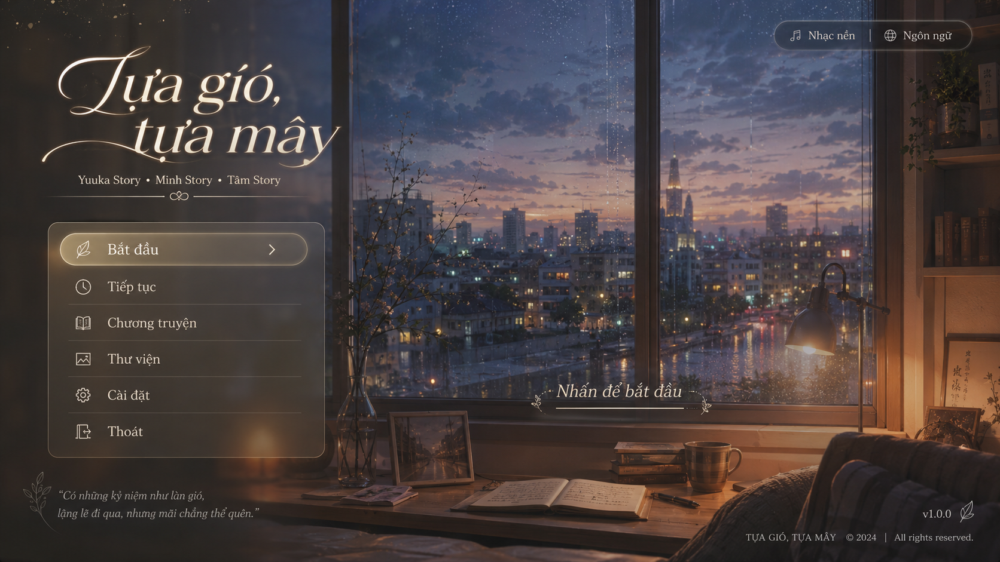

# Technical Implementation Guide

## Main Menu UI for *Tựa Gió, Tựa Mây*


## Custom Main Menu UI with Asset Fallbacks

## 1. Goal

Implement a custom PC-first main menu for *Tựa Gió, Tựa Mây* using custom assets when available, while providing safe fallback displayables when assets are missing.

The menu should:

* Use a clean full-screen background.
* Render custom logo, menu panel, buttons, icons, top controls, quote, version text.
* Open the existing `route_map` flow from the “Chương truyện” button.
* Avoid hard crashes if UI assets are missing.
* Focus on 1920x1080 PC layout first.
* Keep mobile adaptation for a later phase.

---

## 2. Base Resolution

```renpy
define config.screen_width = 1920
define config.screen_height = 1080
```

All coordinates below assume 1920x1080.

---

## 3. Asset Structure

Recommended:

```text
game/
  gui/
    main_menu/
      bg_main_menu.webp
      logo_tua_gio_tua_may.png

      panel_main.png
      button_primary_idle.png
      button_primary_hover.png
      button_hover.png
      divider.png

      icon_leaf.png
      icon_continue.png
      icon_chapter.png
      icon_gallery.png
      icon_settings.png
      icon_exit.png
      icon_music.png
      icon_language.png
```

All asset paths used in Ren’Py should be relative to `game/`, for example:

```renpy
"gui/main_menu/bg_main_menu.webp"
```

Not:

```renpy
"game/gui/main_menu/bg_main_menu.webp"
```

---

## 4. Fallback Asset Resolver

Create:

```text
game/main_menu_safe_assets.rpy
```

```renpy
init -20 python:

    MM_ASSET_CACHE = {}

    def mm_loadable(path):
        """
        Returns True if the asset exists and can be loaded by Ren'Py.
        """
        return bool(path) and renpy.loadable(path)


    def mm_image(path, fallback_color="#00000000"):
        """
        Returns an image if available, otherwise a Solid fallback.
        """
        key = ("image", path, fallback_color)

        if key not in MM_ASSET_CACHE:
            if mm_loadable(path):
                MM_ASSET_CACHE[key] = Image(path)
            else:
                MM_ASSET_CACHE[key] = Solid(fallback_color)

        return MM_ASSET_CACHE[key]


    def mm_optional_image(path, width=0, height=0):
        """
        Returns an image if available, otherwise an invisible Null displayable.
        Useful for decorative assets.
        """
        key = ("optional", path, width, height)

        if key not in MM_ASSET_CACHE:
            if mm_loadable(path):
                MM_ASSET_CACHE[key] = Image(path)
            else:
                MM_ASSET_CACHE[key] = Null(width, height)

        return MM_ASSET_CACHE[key]


    def mm_frame(path, fallback_color="#2d261fb8", borders=(32, 32, 32, 32)):
        """
        Returns a Frame if the asset exists.
        Falls back to a simple translucent color block.
        """
        key = ("frame", path, fallback_color, borders)

        if key not in MM_ASSET_CACHE:
            if mm_loadable(path):
                MM_ASSET_CACHE[key] = Frame(path, *borders)
            else:
                MM_ASSET_CACHE[key] = Solid(fallback_color)

        return MM_ASSET_CACHE[key]
```

This prevents common Ren’Py missing image crashes.

---

## 5. Main Menu Screen

Create:

```text
game/screens_main_menu_custom.rpy
```

```renpy
screen main_menu():

    tag menu

    add mm_image(
        "gui/main_menu/bg_main_menu.webp",
        fallback_color="#15120f"
    ) fit "cover"

    use main_menu_logo
    use main_menu_navigation
    use main_menu_top_controls
    use main_menu_bottom_text
```

---

## 6. Logo Area with Fallback

```renpy
screen main_menu_logo():

    fixed:
        xpos 90
        ypos 70
        xsize 650
        ysize 300

        if mm_loadable("gui/main_menu/logo_tua_gio_tua_may.png"):
            add "gui/main_menu/logo_tua_gio_tua_may.png":
                xpos 0
                ypos 0
        else:
            vbox:
                spacing 4

                text "Tựa gió,":
                    size 88
                    color "#fff0d6"
                    italic True
                    outlines [(2, "#00000088", 0, 2)]

                text "tựa mây":
                    size 88
                    color "#fff0d6"
                    italic True
                    outlines [(2, "#00000088", 0, 2)]

        text "Yuuka Story  •  Minh Story  •  Tâm Story":
            xpos 55
            ypos 245
            size 25
            color "#efe1cb"
            outlines [(1, "#00000088", 0, 1)]
```

Recommendation: final logo should be a transparent PNG. The fallback text is only for development safety.

---

## 7. Navigation Panel

```renpy
screen main_menu_navigation():

    frame:
        xpos 95
        ypos 430
        xsize 540
        ysize 420
        background mm_frame(
            "gui/main_menu/panel_main.png",
            fallback_color="#2d261fc0",
            borders=(36, 36, 36, 36)
        )

        vbox:
            xpos 24
            ypos 22
            spacing 0

            use main_menu_nav_button(
                label=_("Bắt đầu"),
                icon="gui/main_menu/icon_leaf.png",
                fallback_icon="❧",
                action=Start(),
                primary=True
            )

            use main_menu_nav_button(
                label=_("Tiếp tục"),
                icon="gui/main_menu/icon_continue.png",
                fallback_icon="◷",
                action=ShowMenu("load"),
                primary=False
            )

            use main_menu_nav_button(
                label=_("Chương truyện"),
                icon="gui/main_menu/icon_chapter.png",
                fallback_icon="▦",
                action=Start("route_map"),
                primary=False
            )

            use main_menu_nav_button(
                label=_("Thư viện"),
                icon="gui/main_menu/icon_gallery.png",
                fallback_icon="▧",
                action=ShowMenu("gallery"),
                primary=False
            )

            use main_menu_nav_button(
                label=_("Cài đặt"),
                icon="gui/main_menu/icon_settings.png",
                fallback_icon="⚙",
                action=ShowMenu("preferences"),
                primary=False
            )

            use main_menu_nav_button(
                label=_("Thoát"),
                icon="gui/main_menu/icon_exit.png",
                fallback_icon="⇱",
                action=Quit(confirm=True),
                primary=False
            )
```

Important point: `Chương truyện` should use:

```renpy
Start("route_map")
```

This is safer than `ShowMenu("route_map")` if the route map currently exists as a gameplay label rather than a pure menu screen.

---

## 8. Reusable Button with Fallback

```renpy
screen main_menu_nav_button(label, icon, fallback_icon, action, primary=False):

    $ idle_bg = mm_image("gui/main_menu/button_primary_idle.png", "#a58b5a50") if primary else Solid("#00000000")
    $ hover_bg = mm_image("gui/main_menu/button_primary_hover.png", "#c8aa7048") if primary else mm_image("gui/main_menu/button_hover.png", "#ffffff16")

    button:
        xsize 492
        ysize 64
        background idle_bg
        hover_background hover_bg
        action action

        hbox:
            xfill True
            yalign 0.5
            spacing 24

            fixed:
                xsize 40
                ysize 40
                yalign 0.5

                if mm_loadable(icon):
                    add icon:
                        xalign 0.5
                        yalign 0.5
                        xsize 32
                        ysize 32
                else:
                    text fallback_icon:
                        xalign 0.5
                        yalign 0.5
                        size 30
                        color "#efe4d4"

            text label:
                size 30
                color "#efe4d4"
                hover_color "#fff4dd"
                yalign 0.5

            null width 0

            if primary:
                text "›":
                    size 40
                    color "#fff2d0"
                    xalign 1.0
                    yalign 0.5

    add mm_optional_image("gui/main_menu/divider.png", 455, 1):
        xsize 455
        ysize 1
        alpha 0.35
        xalign 0.5
```

Fallback result:

* Missing button asset → translucent color block.
* Missing icon → Unicode symbol.
* Missing divider → invisible `Null`.

Game still opens. No drama. Very civilised.

---

## 9. Top-right Controls

```renpy
screen main_menu_top_controls():

    frame:
        xpos 1460
        ypos 40
        xsize 380
        ysize 58
        background mm_frame(
            "gui/main_menu/panel_main.png",
            fallback_color="#2d261fb0",
            borders=(28, 28, 28, 28)
        )

        hbox:
            xalign 0.5
            yalign 0.5
            spacing 22

            textbutton _("♪  Nhạc nền"):
                text_size 23
                text_color "#efe4d4"
                text_hover_color "#ffffff"
                action Preference("music mute", "toggle")

            text "|":
                size 24
                color "#efe4d477"

            textbutton _("◎  Ngôn ngữ"):
                text_size 23
                text_color "#efe4d4"
                text_hover_color "#ffffff"
                action ShowMenu("language_menu")
```

Later, replace text icons with PNG icons if desired.

---

## 10. Language Menu

```renpy
screen language_menu():

    tag menu

    add mm_image(
        "gui/main_menu/bg_main_menu.webp",
        fallback_color="#15120f"
    ) fit "cover"

    frame:
        xalign 0.5
        yalign 0.5
        xsize 520
        ysize 300
        background mm_frame(
            "gui/main_menu/panel_main.png",
            fallback_color="#2d261fd8",
            borders=(36, 36, 36, 36)
        )

        vbox:
            xalign 0.5
            yalign 0.5
            spacing 24

            text _("Ngôn ngữ"):
                size 36
                color "#fff1dc"
                xalign 0.5

            textbutton "Tiếng Việt":
                xalign 0.5
                action Language("vietnamese")

            textbutton "English":
                xalign 0.5
                action Language("english")

            textbutton _("Quay lại"):
                xalign 0.5
                action Return()
```

The language IDs must match the actual folders under:

```text
game/tl/
```

Example:

```text
game/tl/vietnamese/
game/tl/english/
```

---

## 11. Bottom Text

```renpy
screen main_menu_bottom_text():

    text "“Có những kỷ niệm như làn gió,\nlặng lẽ đi qua, nhưng mãi chẳng thể quên.”":
        xpos 95
        ypos 920
        size 24
        color "#e9dcc7cc"
        italic True
        line_spacing 10
        outlines [(1, "#00000088", 0, 1)]

    text "Nhấn để bắt đầu":
        xalign 0.63
        ypos 745
        size 31
        color "#f2e1c8"
        italic True
        outlines [(1, "#00000088", 0, 1)]

    text "v1.0.0":
        xpos 1750
        ypos 955
        size 22
        color "#e9dcc7cc"

    text "TỰA GIÓ, TỰA MÂY   © 2024  |  All rights reserved.":
        xpos 1410
        ypos 1015
        size 18
        color "#e9dcc7aa"
```

---

## 12. Optional Developer Warning for Missing Assets

During development, it can be useful to show a small warning when assets are missing.

```renpy
define config.developer = True
```

Add helper:

```renpy
init -20 python:

    def mm_missing_assets(paths):
        return [p for p in paths if not mm_loadable(p)]
```

Debug screen:

```renpy
screen main_menu_asset_debug():

    if config.developer:
        $ missing = mm_missing_assets([
            "gui/main_menu/bg_main_menu.webp",
            "gui/main_menu/logo_tua_gio_tua_may.png",
            "gui/main_menu/panel_main.png",
            "gui/main_menu/button_primary_idle.png",
            "gui/main_menu/button_primary_hover.png",
            "gui/main_menu/button_hover.png",
            "gui/main_menu/icon_leaf.png",
            "gui/main_menu/icon_continue.png",
            "gui/main_menu/icon_chapter.png",
            "gui/main_menu/icon_gallery.png",
            "gui/main_menu/icon_settings.png",
            "gui/main_menu/icon_exit.png",
        ])

        if missing:
            frame:
                xpos 20
                ypos 20
                background Solid("#000000aa")

                vbox:
                    spacing 4

                    text "Missing Main Menu Assets:":
                        size 18
                        color "#ffcc66"

                    for item in missing:
                        text item:
                            size 14
                            color "#ffffffcc"
```

Then call it inside `screen main_menu()`:

```renpy
use main_menu_asset_debug
```

Remove or disable this in release builds.

---

## 13. Future Mobile Phase

Do not mix mobile logic into this PC implementation yet. Just structure screens cleanly so they can later branch like this:

```renpy
screen main_menu():

    tag menu

    if renpy.variant("touch"):
        use main_menu_mobile
    else:
        use main_menu_pc
```

For now:

```renpy
screen main_menu():
    tag menu
    use main_menu_pc
```

Then put the current implementation into:

```renpy
screen main_menu_pc():
    ...
```

This avoids future refactor pain.

---

## 14. Recommended Implementation Order

1. Add `main_menu_safe_assets.rpy`.
2. Add `screens_main_menu_custom.rpy`.
3. Place only the clean background first.
4. Test launch.
5. Add logo.
6. Add menu panel.
7. Add buttons one by one.
8. Connect `Chương truyện` to `Start("route_map")`.
9. Add top controls.
10. Add language menu.
11. Add fallback debug screen.
12. Run Ren’Py lint.

---
