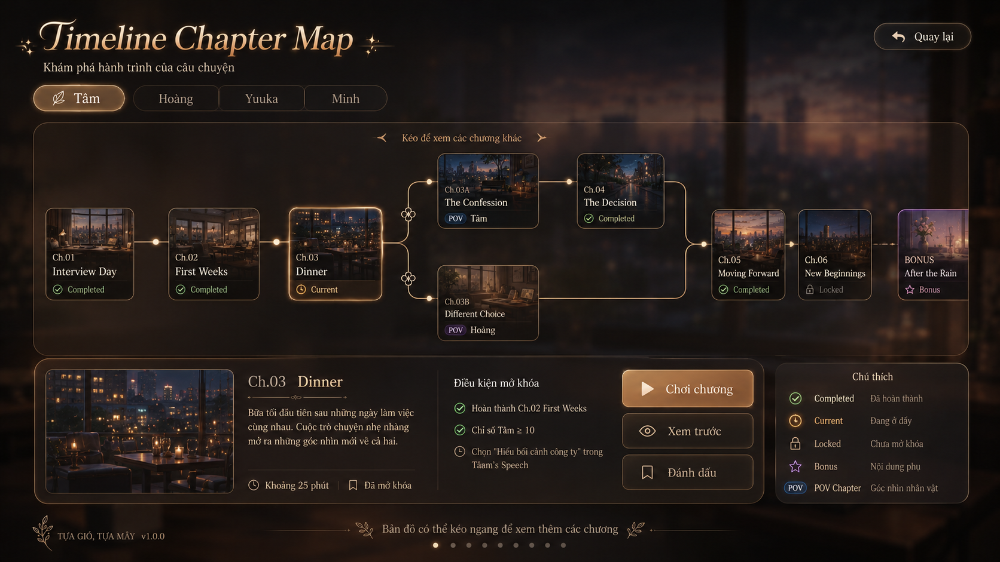

# Technical Guide: Timeline Chapter Map UI Implementation in Ren’Py

## UI Design
The timeline chapter map is a visual interface that allows players to see the structure of the story, track their progress, and access different chapters. It should be designed to be intuitive, visually appealing, and informative. The map will display chapters as nodes connected by lines, with different colors and icons to indicate their status (completed, current, locked, bonus, POV). Players can click on nodes to view details and access actions like playing the chapter or previewing it.

## 1. Goal

Implement a **horizontal chapter timeline map** for the visual novel.

The screen should support:

```text
- Route tabs: Tâm / Hoàng / Yuuka / Minh
- Horizontal chapter flow
- Chapter thumbnail cards
- Connected lines between chapters
- Branching and merging paths
- Chapter states: Completed / Current / Locked / Bonus / POV
- Detail panel for selected chapter
- Play / Preview / Bookmark buttons
- Horizontal scrolling for long timelines
```

This should be implemented using **Ren’Py Screen Language**, not as one flat image. Ren’Py screens are intended for custom UI, and screen actions are used to handle button interactions such as returning a selected chapter from a screen. ([Ren'Py][1])

---

# 2. Implementation Principle

## Use the mockup as a visual target, not as a single UI image

Do **not** bake the full design into one image.

Bad approach:

```text
timeline_map_full_mockup.png
```

This would make the map:

```text
- impossible to update dynamically
- hard to localize
- hard to scroll
- hard to show locked/completed states
- hard to reuse for different routes
```

Correct approach:

```text
Background image
+ translucent panels
+ route tab buttons
+ node cards
+ line segments
+ thumbnail images
+ detail panel
+ action buttons
```

The chapter map should be data-driven.

---

# 3. File Structure

Recommended structure:

```text
game/
  images/
    assets/
      bg/
        ui/
          bg_timeline_map_blur.webp

      ui/
        timeline/
          panel_large.png                  # optional
          panel_detail.png                 # optional
          node_core_idle.png               # optional
          node_core_hover.png              # optional
          node_current.png                 # optional
          node_locked.png                  # optional
          node_bonus.png                   # optional
          node_pov.png                     # optional
          line_horizontal.png              # optional
          line_vertical.png                # optional
          line_corner.png                  # optional
          icon_completed.png               # optional
          icon_current.png                 # optional
          icon_locked.png                  # optional
          icon_bonus.png                   # optional
          icon_pov.png                     # optional

      thumbnails/
        tam/
          tam_c01.webp
          tam_c02.webp
          tam_c03.webp
          tam_c03a.webp
          tam_c03b.webp
          tam_c04.webp
          tam_c05.webp
          tam_c06.webp
          tam_bonus_after_rain.webp

  timeline_map_data.rpy
  timeline_map_screen.rpy
  timeline_map_styles.rpy
```

For the first implementation, the Agent may skip most optional PNG UI assets and use Ren’Py `Solid`, `Frame`, `textbutton`, and `button`.

---

# 4. Data Model

Create:

```text
game/timeline_map_data.rpy
```

This file stores UI-specific layout metadata. The actual unlock logic should still come from the existing progression system.

```renpy
# ============================================================
# Timeline Chapter Map Data
# ============================================================

init python:

    TIMELINE_ROUTES = [
        {
            "id": "tam",
            "label": "Tâm",
        },
        {
            "id": "hoang",
            "label": "Hoàng",
        },
        {
            "id": "yuuka",
            "label": "Yuuka",
        },
        {
            "id": "minh",
            "label": "Minh",
        },
    ]


    TIMELINE_NODE_TYPES = {
        "core": "Core Chapter",
        "pov": "POV Chapter",
        "bonus": "Bonus Chapter",
        "extra": "Extra Chapter",
    }


    # Coordinates are inside the scrollable map canvas, not the full screen.
    # Keep all node positions absolute for easier branch control.
    #
    # x/y are top-left positions.
    # w/h should stay consistent for implementation simplicity.
    TIMELINE_MAP_NODES = {
        "tam": [
            {
                "id": "tam_c01",
                "chapter_id": "tam_c01",
                "title": "Interview Day",
                "code": "Ch.01",
                "type": "core",
                "thumbnail": "images/assets/thumbnails/tam/tam_c01.webp",
                "summary": "Tâm attends her first job interview and prepares her speech.",
                "duration": "Approx. 20 min",
                "x": 40,
                "y": 150,
                "w": 170,
                "h": 175,
            },
            {
                "id": "tam_c02",
                "chapter_id": "tam_c02",
                "title": "First Weeks",
                "code": "Ch.02",
                "type": "core",
                "thumbnail": "images/assets/thumbnails/tam/tam_c02.webp",
                "summary": "The first weeks at work begin to shape Tâm’s confidence.",
                "duration": "Approx. 25 min",
                "x": 300,
                "y": 150,
                "w": 170,
                "h": 175,
            },
            {
                "id": "tam_c03",
                "chapter_id": "tam_c03",
                "title": "Dinner",
                "code": "Ch.03",
                "type": "core",
                "thumbnail": "images/assets/thumbnails/tam/tam_c03.webp",
                "summary": "A quiet dinner opens a new angle on work, friendship, and fate.",
                "duration": "Approx. 25 min",
                "x": 560,
                "y": 150,
                "w": 170,
                "h": 175,
            },
            {
                "id": "tam_c03a",
                "chapter_id": "tam_c03a",
                "title": "The Confession",
                "code": "Ch.03A",
                "type": "pov",
                "pov": "Tâm",
                "thumbnail": "images/assets/thumbnails/tam/tam_c03a.webp",
                "summary": "A branch focused on Tâm’s emotional response.",
                "duration": "Approx. 15 min",
                "x": 870,
                "y": 40,
                "w": 170,
                "h": 175,
            },
            {
                "id": "tam_c03b",
                "chapter_id": "tam_c03b",
                "title": "Different Choice",
                "code": "Ch.03B",
                "type": "pov",
                "pov": "Hoàng",
                "thumbnail": "images/assets/thumbnails/tam/tam_c03b.webp",
                "summary": "A branch that shifts the focus toward Hoàng’s point of view.",
                "duration": "Approx. 15 min",
                "x": 870,
                "y": 270,
                "w": 170,
                "h": 175,
            },
            {
                "id": "tam_c04",
                "chapter_id": "tam_c04",
                "title": "The Decision",
                "code": "Ch.04",
                "type": "core",
                "thumbnail": "images/assets/thumbnails/tam/tam_c04.webp",
                "summary": "Tâm makes a decision that affects her future route direction.",
                "duration": "Approx. 30 min",
                "x": 1160,
                "y": 40,
                "w": 170,
                "h": 175,
            },
            {
                "id": "tam_c05",
                "chapter_id": "tam_c05",
                "title": "Moving Forward",
                "code": "Ch.05",
                "type": "core",
                "thumbnail": "images/assets/thumbnails/tam/tam_c05.webp",
                "summary": "The route returns to the main emotional thread.",
                "duration": "Approx. 25 min",
                "x": 1450,
                "y": 150,
                "w": 170,
                "h": 175,
            },
            {
                "id": "tam_c06",
                "chapter_id": "tam_c06",
                "title": "New Beginnings",
                "code": "Ch.06",
                "type": "core",
                "thumbnail": "images/assets/thumbnails/tam/tam_c06.webp",
                "summary": "A locked future chapter.",
                "duration": "Approx. 30 min",
                "x": 1700,
                "y": 150,
                "w": 170,
                "h": 175,
            },
            {
                "id": "tam_bonus_after_rain",
                "chapter_id": "tam_bonus_after_rain",
                "title": "After the Rain",
                "code": "BONUS",
                "type": "bonus",
                "thumbnail": "images/assets/thumbnails/tam/tam_bonus_after_rain.webp",
                "summary": "Optional bonus content unlocked by specific route conditions.",
                "duration": "Approx. 12 min",
                "x": 1950,
                "y": 150,
                "w": 170,
                "h": 175,
            },
        ],
    }


    # Connections are manually defined as line segments.
    # This is more reliable than trying to auto-route curved paths.
    TIMELINE_MAP_CONNECTIONS = {
        "tam": [
            # Main line: Ch.01 -> Ch.02 -> Ch.03
            { "from": "tam_c01", "to": "tam_c02", "style": "normal" },
            { "from": "tam_c02", "to": "tam_c03", "style": "normal" },

            # Branches from Ch.03
            { "from": "tam_c03", "to": "tam_c03a", "style": "branch" },
            { "from": "tam_c03", "to": "tam_c03b", "style": "branch" },

            # Upper branch
            { "from": "tam_c03a", "to": "tam_c04", "style": "normal" },

            # Merge to Ch.05
            { "from": "tam_c04", "to": "tam_c05", "style": "merge" },
            { "from": "tam_c03b", "to": "tam_c05", "style": "merge" },

            # Future flow
            { "from": "tam_c05", "to": "tam_c06", "style": "normal" },
            { "from": "tam_c06", "to": "tam_bonus_after_rain", "style": "dashed" },
        ],
    }
```

---

# 5. Chapter State Adapter

The UI must read from the existing progression system.

Create helper functions in the same file or a separate file:

```renpy
init python:

    def timeline_get_nodes(route_id):
        return TIMELINE_MAP_NODES.get(route_id, [])


    def timeline_find_node(route_id, node_id):
        for node in timeline_get_nodes(route_id):
            if node["id"] == node_id:
                return node
        return None


    def timeline_find_node_by_chapter(route_id, chapter_id):
        for node in timeline_get_nodes(route_id):
            if node["chapter_id"] == chapter_id:
                return node
        return None


    def timeline_get_chapter_data(chapter_id):
        """
        Adapter to the existing CHAPTERS dict.
        """
        if "CHAPTERS" in globals() and chapter_id in CHAPTERS:
            return CHAPTERS[chapter_id]

        return None


    def timeline_is_completed(chapter_id):
        """
        Adapter to the current progression structure.
        Adjust this if your progress key differs.
        """
        try:
            return chapter_id in progress.get("completed", [])
        except Exception:
            return False


    def timeline_is_excluded(chapter_id):
        try:
            return chapter_id in progress.get("excluded", [])
        except Exception:
            return False


    def timeline_is_available(chapter_id):
        """
        Preferred:
        Use your existing progression function if available.

        Fallback:
        Check basic prerequisites from CHAPTERS.
        """
        if timeline_is_completed(chapter_id):
            return False

        if timeline_is_excluded(chapter_id):
            return False

        # If the project already has a function for availability, use it.
        if "chapter_is_available" in globals():
            return chapter_is_available(chapter_id)

        chapter = timeline_get_chapter_data(chapter_id)

        if not chapter:
            return False

        prerequisites = chapter.get("prerequisites", [])

        for prerequisite_id in prerequisites:
            if not timeline_is_completed(prerequisite_id):
                return False

        return True


    def timeline_get_node_state(node):
        chapter_id = node["chapter_id"]

        if timeline_is_completed(chapter_id):
            return "completed"

        if timeline_is_excluded(chapter_id):
            return "locked"

        if timeline_is_available(chapter_id):
            return "current"

        return "locked"


    def timeline_get_first_selectable_node(route_id):
        """
        Select current node first.
        If none exists, select the first node.
        """
        nodes = timeline_get_nodes(route_id)

        for node in nodes:
            if timeline_get_node_state(node) == "current":
                return node["id"]

        if nodes:
            return nodes[0]["id"]

        return None
```

The Agent should adapt `progress["completed"]`, `progress["excluded"]`, and `chapter_is_available()` to match the real project if the internal names differ.

---

# 6. Screen Implementation

Create:

```text
game/timeline_map_screen.rpy
```

## 6.1 Main screen

This screen uses a horizontal `viewport` with an ID. Ren’Py supports scrollable viewports, and the official docs recommend assigning an ID and using `XScrollValue()` / `YScrollValue()` for scrollbars. ([Ren'Py][1])

```renpy
# ============================================================
# Timeline Chapter Map Screen
# ============================================================

screen timeline_chapter_map(route_id="tam"):

    tag menu
    modal True

    default selected_route = route_id
    default selected_node_id = timeline_get_first_selectable_node(route_id)

    $ nodes = timeline_get_nodes(selected_route)
    $ selected_node = timeline_find_node(selected_route, selected_node_id)

    fixed:
        xysize (1920, 1080)

        add "images/assets/bg/ui/bg_timeline_map_blur.webp"

        add Solid("#00000099")

        # ----------------------------------------------------
        # Header
        # ----------------------------------------------------

        text "Timeline Chapter Map":
            style "timeline_title"
            xpos 80
            ypos 42

        text "Khám phá hành trình của câu chuyện":
            style "timeline_subtitle"
            xpos 84
            ypos 118

        textbutton "↩  Quay lại":
            style "timeline_back_button"
            text_style "timeline_back_button_text"
            xpos 1670
            ypos 48
            action Return(("back", None))

        # ----------------------------------------------------
        # Route tabs
        # ----------------------------------------------------

        hbox:
            xpos 80
            ypos 158
            spacing 14

            for route in TIMELINE_ROUTES:

                $ is_selected = route["id"] == selected_route

                textbutton route["label"]:
                    style "timeline_route_tab_selected" if is_selected else "timeline_route_tab"
                    text_style "timeline_route_tab_text_selected" if is_selected else "timeline_route_tab_text"
                    action [
                        SetScreenVariable("selected_route", route["id"]),
                        SetScreenVariable("selected_node_id", timeline_get_first_selectable_node(route["id"]))
                    ]

        # ----------------------------------------------------
        # Main map panel
        # ----------------------------------------------------

        frame:
            style "timeline_map_panel"
            xpos 64
            ypos 236
            xysize (1792, 430)

            fixed:

                text "‹  Kéo để xem các chương khác  ›":
                    style "timeline_scroll_hint"
                    xalign 0.5
                    ypos 18

                viewport:
                    id "timeline_map_viewport"
                    xpos 24
                    ypos 60
                    xsize 1744
                    ysize 320
                    draggable True
                    mousewheel True

                    fixed:
                        xysize (2200, 320)

                        # Connections first, behind nodes.
                        for connection in TIMELINE_MAP_CONNECTIONS.get(selected_route, []):
                            use timeline_connection_line(selected_route, connection)

                        # Nodes above lines.
                        for node in nodes:
                            use timeline_node_card(node, selected_node_id)

                # Horizontal scrollbar.
                bar:
                    value XScrollValue("timeline_map_viewport")
                    style "timeline_horizontal_scrollbar"
                    xpos 420
                    ypos 390
                    xsize 920
                    ysize 12

        # ----------------------------------------------------
        # Detail panel
        # ----------------------------------------------------

        if selected_node:
            use timeline_detail_panel(selected_node)

        # ----------------------------------------------------
        # Legend
        # ----------------------------------------------------

        use timeline_legend_panel()

        # ----------------------------------------------------
        # Footer
        # ----------------------------------------------------

        text "TỰA GIÓ, TỰA MÂY   v1.0.0":
            style "timeline_footer_text"
            xpos 80
            ypos 1000

        text "Bản đồ có thể kéo ngang để xem thêm các chương":
            style "timeline_footer_hint"
            xalign 0.5
            ypos 1000
```

---

# 7. Node Card Screen

```renpy
screen timeline_node_card(node, selected_node_id):

    $ state = timeline_get_node_state(node)
    $ is_selected = node["id"] == selected_node_id
    $ node_type = node.get("type", "core")

    button:
        xpos node["x"]
        ypos node["y"]
        xysize (node["w"], node["h"])

        style "timeline_node_selected" if is_selected else "timeline_node"

        action SetScreenVariable("selected_node_id", node["id"])

        fixed:
            xysize (node["w"], node["h"])

            # Thumbnail
            add node["thumbnail"]:
                xpos 8
                ypos 8
                xsize node["w"] - 16
                ysize 78

            # Dark thumbnail gradient / lower text area.
            add Solid("#00000088"):
                xpos 8
                ypos 82
                xsize node["w"] - 16
                ysize 84

            text node["code"]:
                style "timeline_node_code"
                xpos 14
                ypos 92

            text node["title"]:
                style "timeline_node_title"
                xpos 14
                ypos 118
                xmaximum node["w"] - 28

            # Status badge
            hbox:
                xpos 14
                ypos 148
                spacing 6

                if state == "completed":
                    text "✓" style "timeline_status_completed_icon"
                    text "Completed" style "timeline_status_completed_text"

                elif state == "current":
                    text "◷" style "timeline_status_current_icon"
                    text "Current" style "timeline_status_current_text"

                elif state == "locked":
                    text "🔒" style "timeline_status_locked_icon"
                    text "Locked" style "timeline_status_locked_text"

            # Type badge
            if node_type == "bonus":
                text "★ Bonus":
                    style "timeline_badge_bonus"
                    xpos 90
                    ypos 148

            elif node_type == "pov":
                text "POV":
                    style "timeline_badge_pov"
                    xpos 90
                    ypos 148
```

---

# 8. Connection Lines

For MVP, use simple straight line segments with `Solid`.

This is much easier to implement than curved lines. Curves and rounded junctions can be added later as PNG assets.

```renpy
screen timeline_connection_line(route_id, connection):

    $ from_node = timeline_find_node(route_id, connection["from"])
    $ to_node = timeline_find_node(route_id, connection["to"])

    if from_node and to_node:

        $ from_x = from_node["x"] + from_node["w"]
        $ from_y = from_node["y"] + int(from_node["h"] / 2)

        $ to_x = to_node["x"]
        $ to_y = to_node["y"] + int(to_node["h"] / 2)

        $ mid_x = int((from_x + to_x) / 2)

        # Same row: draw one horizontal line.
        if abs(from_y - to_y) < 20:

            add Solid("#D7B77D"):
                xpos from_x
                ypos from_y
                xsize max(1, to_x - from_x)
                ysize 3

            add Solid("#F5D7A6"):
                xpos to_x - 5
                ypos to_y - 5
                xsize 10
                ysize 10

        # Different row: draw elbow connector.
        else:

            # Horizontal from source to mid.
            add Solid("#D7B77D"):
                xpos from_x
                ypos from_y
                xsize max(1, mid_x - from_x)
                ysize 3

            # Vertical at mid.
            add Solid("#D7B77D"):
                xpos mid_x
                ypos min(from_y, to_y)
                xsize 3
                ysize abs(to_y - from_y)

            # Horizontal from mid to target.
            add Solid("#D7B77D"):
                xpos mid_x
                ypos to_y
                xsize max(1, to_x - mid_x)
                ysize 3

            # Endpoint dot.
            add Solid("#F5D7A6"):
                xpos to_x - 5
                ypos to_y - 5
                xsize 10
                ysize 10
```

## Optional polish

Replace plain `Solid` lines with image assets:

```text
line_horizontal.png
line_vertical.png
line_corner_tl.png
line_corner_tr.png
line_corner_bl.png
line_corner_br.png
junction_dot.png
```

This will get closer to the mockup.

---

# 9. Detail Panel

```renpy
screen timeline_detail_panel(node):

    $ state = timeline_get_node_state(node)
    $ chapter_id = node["chapter_id"]
    $ can_play = state == "current"

    frame:
        style "timeline_detail_panel"
        xpos 64
        ypos 690
        xysize (1430, 260)

        fixed:

            add node["thumbnail"]:
                xpos 24
                ypos 24
                xysize (360, 210)

            text "[node['code']]  [node['title']]":
                style "timeline_detail_title"
                xpos 420
                ypos 36

            text node.get("summary", ""):
                style "timeline_detail_summary"
                xpos 420
                ypos 92
                xmaximum 420

            hbox:
                xpos 420
                ypos 205
                spacing 24

                text "◷ [node.get('duration', 'Approx. 20 min')]" style "timeline_detail_meta"

                if state == "locked":
                    text "🔒 Locked" style "timeline_detail_meta_locked"
                else:
                    text "▱ Unlocked" style "timeline_detail_meta"

            # Requirements block
            text "Điều kiện mở khóa":
                style "timeline_requirements_title"
                xpos 820
                ypos 40

            vbox:
                xpos 820
                ypos 82
                spacing 12

                use timeline_requirement_line(True, "Hoàn thành chương trước")
                use timeline_requirement_line(True, "Đạt chỉ số route yêu cầu")
                use timeline_requirement_line(False, "Một số lựa chọn có thể mở nhánh phụ")

            # Buttons
            vbox:
                xpos 1170
                ypos 34
                spacing 14

                textbutton "▶  Chơi chương":
                    style "timeline_play_button"
                    text_style "timeline_play_button_text"
                    sensitive can_play
                    action Return(("play", chapter_id))

                textbutton "◎  Xem trước":
                    style "timeline_secondary_button"
                    text_style "timeline_secondary_button_text"
                    action Return(("preview", chapter_id))

                textbutton "▱  Đánh dấu":
                    style "timeline_secondary_button"
                    text_style "timeline_secondary_button_text"
                    action Return(("bookmark", chapter_id))


screen timeline_requirement_line(done, label):

    hbox:
        spacing 8

        if done:
            text "✓" style "timeline_status_completed_icon"
        else:
            text "○" style "timeline_status_locked_icon"

        text label style "timeline_requirement_text"
```

---

# 10. Legend Panel

```renpy
screen timeline_legend_panel():

    frame:
        style "timeline_legend_panel"
        xpos 1518
        ypos 690
        xysize (338, 260)

        vbox:
            xpos 28
            ypos 26
            spacing 13

            text "Chú thích" style "timeline_legend_title"

            use timeline_legend_row("✓", "Completed", "Đã hoàn thành", "completed")
            use timeline_legend_row("◷", "Current", "Đang ở đây", "current")
            use timeline_legend_row("🔒", "Locked", "Chưa mở khóa", "locked")
            use timeline_legend_row("★", "Bonus", "Nội dung phụ", "bonus")
            use timeline_legend_row("POV", "POV Chapter", "Góc nhìn nhân vật", "pov")


screen timeline_legend_row(icon, label, desc, kind):

    hbox:
        spacing 12

        text icon:
            style "timeline_legend_icon_" + kind

        vbox:
            spacing 0

            text label style "timeline_legend_label"
            text desc style "timeline_legend_desc"
```

If Ren’Py complains about dynamic style names in:

```renpy
style "timeline_legend_icon_" + kind
```

replace it with explicit `if/elif` blocks. Ren’Py can be very civil until it suddenly decides string composition is a personal insult.

---

# 11. Styles

Create:

```text
game/timeline_map_styles.rpy
```

```renpy
# ============================================================
# Timeline Chapter Map Styles
# ============================================================

style timeline_title is default:
    size 56
    bold True
    color "#F5D7A6"
    outlines [(2, "#1A0E05", 0, 0)]


style timeline_subtitle is default:
    size 24
    color "#EADAC4"
    outlines [(1, "#000000", 0, 0)]


style timeline_back_button is button:
    background Solid("#1A1510CC")
    hover_background Solid("#3A2C1ECC")
    xysize (170, 56)
    padding (18, 10)


style timeline_back_button_text is button_text:
    size 22
    color "#F5E5CB"
    hover_color "#FFDDAA"


style timeline_route_tab is button:
    background Solid("#18120ECC")
    hover_background Solid("#312419DD")
    xysize (160, 50)
    padding (16, 8)


style timeline_route_tab_selected is button:
    background Solid("#A8743BDD")
    hover_background Solid("#C98A48EE")
    xysize (160, 50)
    padding (16, 8)


style timeline_route_tab_text is button_text:
    size 24
    color "#D6C5AD"
    hover_color "#FFDDAA"


style timeline_route_tab_text_selected is button_text:
    size 24
    bold True
    color "#FFFFFF"


style timeline_map_panel is frame:
    background Solid("#111111CC")
    padding (0, 0)


style timeline_scroll_hint is default:
    size 20
    color "#D7B77D"


style timeline_horizontal_scrollbar is scrollbar:
    base_bar Solid("#4A3825AA")
    thumb Solid("#D7B77D")
    hover_thumb Solid("#F5D7A6")


style timeline_node is button:
    background Solid("#111111DD")
    hover_background Solid("#2B2118EE")
    padding (0, 0)


style timeline_node_selected is button:
    background Solid("#3A2A1BDD")
    hover_background Solid("#4A3320EE")
    padding (0, 0)


style timeline_node_code is default:
    size 18
    color "#EADAC4"
    outlines [(1, "#000000", 0, 0)]


style timeline_node_title is default:
    size 22
    bold True
    color "#FFFFFF"
    line_spacing 0
    outlines [(1, "#000000", 0, 0)]


style timeline_status_completed_icon is default:
    size 18
    color "#8EE083"


style timeline_status_completed_text is default:
    size 16
    color "#A6E99C"


style timeline_status_current_icon is default:
    size 18
    color "#FFD17A"


style timeline_status_current_text is default:
    size 16
    color "#FFD17A"


style timeline_status_locked_icon is default:
    size 18
    color "#9C8D7C"


style timeline_status_locked_text is default:
    size 16
    color "#9C8D7C"


style timeline_badge_bonus is default:
    size 16
    color "#E7A0FF"
    outlines [(1, "#000000", 0, 0)]


style timeline_badge_pov is default:
    size 16
    color "#A8C8FF"
    outlines [(1, "#000000", 0, 0)]


style timeline_detail_panel is frame:
    background Solid("#111111DD")
    padding (0, 0)


style timeline_detail_title is default:
    size 34
    bold True
    color "#F5D7A6"
    outlines [(1, "#000000", 0, 0)]


style timeline_detail_summary is default:
    size 22
    color "#F3E6D0"
    line_spacing 4
    outlines [(1, "#000000", 0, 0)]


style timeline_detail_meta is default:
    size 18
    color "#D7C7B2"


style timeline_detail_meta_locked is default:
    size 18
    color "#9C8D7C"


style timeline_requirements_title is default:
    size 24
    bold True
    color "#F5D7A6"


style timeline_requirement_text is default:
    size 18
    color "#EADAC4"


style timeline_play_button is button:
    background Solid("#C98A48")
    hover_background Solid("#E2A85F")
    insensitive_background Solid("#655342")
    xysize (240, 64)
    padding (18, 10)


style timeline_play_button_text is button_text:
    size 26
    bold True
    color "#FFFFFF"
    insensitive_color "#B8B8B8"


style timeline_secondary_button is button:
    background Solid("#1C1612DD")
    hover_background Solid("#302319EE")
    xysize (240, 58)
    padding (18, 10)


style timeline_secondary_button_text is button_text:
    size 23
    color "#F3E6D0"
    hover_color "#FFDDAA"


style timeline_legend_panel is frame:
    background Solid("#111111DD")
    padding (0, 0)


style timeline_legend_title is default:
    size 24
    bold True
    color "#F5D7A6"


style timeline_legend_label is default:
    size 18
    color "#FFFFFF"


style timeline_legend_desc is default:
    size 15
    color "#BCA98F"


style timeline_legend_icon_completed is default:
    size 18
    color "#8EE083"


style timeline_legend_icon_current is default:
    size 18
    color "#FFD17A"


style timeline_legend_icon_locked is default:
    size 18
    color "#9C8D7C"


style timeline_legend_icon_bonus is default:
    size 18
    color "#E7A0FF"


style timeline_legend_icon_pov is default:
    size 16
    color "#A8C8FF"


style timeline_footer_text is default:
    size 17
    color "#BFAE93"


style timeline_footer_hint is default:
    size 18
    color "#BFAE93"
```

---

# 12. Script Integration

Create or update the route map label.

```renpy
label open_timeline_chapter_map:

    $ timeline_result = renpy.call_screen("timeline_chapter_map", route_id="tam")

    $ timeline_action = timeline_result[0]
    $ timeline_chapter_id = timeline_result[1]

    if timeline_action == "back":
        jump main_menu_screen_or_route_map

    if timeline_action == "play":

        if timeline_chapter_id and timeline_get_chapter_data(timeline_chapter_id):
            $ target_label = timeline_get_chapter_data(timeline_chapter_id).get("label", None)

            if target_label:
                jump expression target_label

        narrator "This chapter cannot be opened yet."
        jump open_timeline_chapter_map

    if timeline_action == "preview":
        # Optional preview screen.
        jump open_timeline_chapter_map

    if timeline_action == "bookmark":
        # Optional bookmark behavior.
        jump open_timeline_chapter_map

    jump open_timeline_chapter_map
```

Replace:

```renpy
jump main_menu_screen_or_route_map
```

with the real return target.

---

# 13. Thumbnail Guidelines

Each chapter card needs a thumbnail.

Recommended source size:

```text
320x180 or 512x288
```

Recommended final display size inside card:

```text
154x78
```

Recommended format:

```text
.webp
```

Thumbnail rules:

```text
- No text baked into thumbnails.
- Use the same visual style as backgrounds.
- Keep images readable even when small.
- Use distinctive color/mood per chapter.
- Avoid character faces if the card is too small.
```

Examples:

```text
tam_c01.webp              interview room / company lobby
tam_c02.webp              office desk / first work days
tam_c03.webp              restaurant dinner / city night
tam_c03a.webp             intimate conversation / warm room
tam_c03b.webp             Hoàng POV / darker office room
tam_c04.webp              rainy street / decision mood
tam_c05.webp              sunrise city / moving forward
tam_c06.webp              night skyline / locked future
tam_bonus_after_rain.webp flowers / rain window / soft bonus mood
```

---

# 14. Feasibility Notes

## Easy in Ren’Py

```text
- Static background
- Route tabs
- Chapter cards
- Clickable nodes
- Status badges
- Detail panel
- Horizontal scrolling
- Play button returning selected chapter
```

## Medium difficulty

```text
- Branching connectors
- Clean line alignment
- Dynamic map width
- Polished hover states
```

## Better with custom assets

```text
- Curved branch lines
- Rounded connector corners
- Glow effects
- Premium gradient buttons
- Decorative ornaments
```

For the MVP, use `Solid` rectangles for connectors. For final polish, replace them with small line and corner PNG assets.

---

# 15. Recommended MVP Scope

Build this first:

```text
- 1 route: Tâm
- 8–10 nodes
- fixed node coordinates
- horizontal viewport
- simple straight/elbow line connectors
- clickable node cards
- selected chapter detail panel
- Play button
- Completed / Current / Locked states
```

Do **not** start with:

```text
- auto-layout graph algorithms
- curved dynamic paths
- animated transitions
- zoomable map
- controller navigation
```

A manually-positioned timeline will be far more stable for this project.

---

# 16. Optional Polish Phase

After MVP works, add:

```text
- line glow PNGs
- node hover sound
- selected-node pulse animation
- smooth fade-in detail panel
- locked-node tooltip
- route tab unlock animation
- bonus chapter sparkle effect
```

Example selected pulse:

```renpy
transform timeline_selected_pulse:
    alpha 1.0
    linear 0.7 alpha 0.72
    linear 0.7 alpha 1.0
    repeat
```

Use it on a subtle highlight layer, not on the whole node card.

---

# 17. QA Checklist

```text
[ ] Screen opens correctly from main menu / route map.
[ ] Tâm tab is selected by default.
[ ] Other route tabs do not crash if route data is missing.
[ ] Horizontal map can be dragged.
[ ] Horizontal scrollbar works.
[ ] Nodes are clickable.
[ ] Selected node updates detail panel.
[ ] Completed chapters show Completed state.
[ ] Available chapter shows Current state.
[ ] Locked chapter shows Locked state.
[ ] Bonus chapter shows Bonus state.
[ ] POV chapter shows POV badge.
[ ] Play button is enabled only for playable/current chapters.
[ ] Locked chapters can be selected for viewing details but cannot be played.
[ ] Branch lines are behind node cards.
[ ] Text does not overflow node cards.
[ ] Thumbnails load correctly.
[ ] Ren’Py lint passes.
```

---

# 18. Final Implementation Recommendation

The design is feasible in Ren’Py if implemented as:

```text
Screen Language UI
+ Data-driven node metadata
+ Manual node coordinates
+ Horizontal viewport
+ Clickable node cards
+ Simple line-segment connectors
+ Detail panel bound to selected node
```

Avoid attempting a dynamic graph layout system. The story structure is authored, not procedurally generated, so a manually curated timeline is cleaner, prettier, and less likely to behave like a cursed spreadsheet wearing lipstick.

[1]: https://www.renpy.org/doc/html/screens.html?utm_source=chatgpt.com "Screens and Screen Language"
